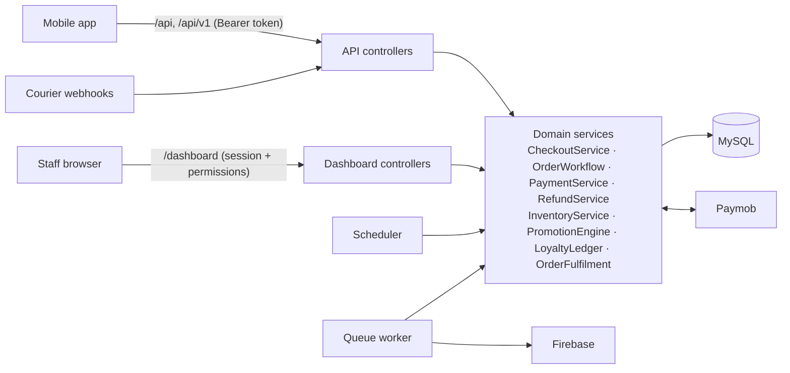

# Alkawthar Pharmacy — backend

Laravel 12 backend of the Alkawthar online pharmacy: the **JSON API** used by the customer mobile app
and the **admin dashboard** used by pharmacy staff. The store sells in **Egypt only, in EGP**, on
Egyptian local time (`Africa/Cairo`). The mobile app itself is a separate project.

## Features

| Area | Highlights |
|---|---|
| Customers | Registration with e-mail OTP, token login, password reset, profile, addresses, favorites, reviews |
| Catalog | Products with sizes/SKUs, categories, brands, health issues, search, best sellers, new arrivals |
| Cart & checkout | Server-side pricing by one promotion engine, automatic gift lines, coupon preview, locked one-transaction checkout |
| Orders | pending → confirmed → picking → packed → on_delivery → completed / canceled, with exactly-once side effects |
| Payments | Cash on delivery (collection + settlement) and Paymob online payments (HMAC + API verified), retries, expiry, recovery |
| Returns & refunds | Return requests, quarantine of returned stock, proportional point reversal, refunds with dual control and reconciliation |
| Delivery | Cities/areas, zones and rates, providers with status maps, shipments, signed courier webhooks |
| Inventory | Multi-warehouse stock in buckets, batches with expiry (FEFO), immutable ledger, transfers, counts, integrity checks |
| Purchasing | Suppliers, purchase orders, goods receipts with lots, invoices, payments, supplier returns |
| Marketing | Discounts, Buy X Get Y, Spend X Get Y tiers, free delivery, flash sales, coupons, campaigns, banners, opening ads |
| Loyalty | Points ledger with lots and expiry, checkout redemption, rewards catalog and redemptions, adjustments |
| Health tools | BMI, blood sugar, blood pressure, ovulation, pregnancy, children's vaccines, medication reminders with push |
| Operations | Roles & permissions (database RBAC), audit log, reports, settings, import/export for 14 data types, contact messages |

## Tech stack

PHP ^8.2 · Laravel 12 · Sanctum · MySQL/MariaDB · database queue/cache · OpenSpout · Blade + Tabler
(self-hosted) · Paymob · Firebase Cloud Messaging · PHPUnit 11.

## Architecture in one picture



Details: [docs/architecture.md](docs/architecture.md).

## Quick start

```bash
composer install
cp .env.example .env            # set DB_*, MAIL_*, Admin_Email, Admin_Password
php artisan key:generate
php artisan migrate --seed      # schema + reference data + first super admin (+ demo data outside production)
php artisan storage:link
php artisan serve               # http://127.0.0.1:8000/login
php artisan queue:work          # in another terminal
php artisan schedule:work       # in another terminal
php artisan test                # 737 tests (SQLite in memory)
```

Production setup, cron, queue, Paymob/FCM go-live and post-deploy checks:
[docs/testing-and-deployment.md](docs/testing-and-deployment.md).

## Documentation

| Document | Content |
|---|---|
| [docs/README.md](docs/README.md) | Documentation index |
| [docs/architecture.md](docs/architecture.md) | System context, stack, request pipeline, module map, design decisions |
| [docs/functional/README.md](docs/functional/README.md) | Functional documentation index |
| [docs/functional/authentication-and-accounts.md](docs/functional/authentication-and-accounts.md) | Authentication, customers, addresses |
| [docs/functional/catalog.md](docs/functional/catalog.md) | Products, sizes, categories, brands, health issues, reviews, favorites |
| [docs/functional/cart-and-checkout.md](docs/functional/cart-and-checkout.md) | Cart and checkout |
| [docs/functional/orders.md](docs/functional/orders.md) | Order lifecycle |
| [docs/functional/payments-and-paymob.md](docs/functional/payments-and-paymob.md) | Payments, Paymob, cash on delivery |
| [docs/functional/returns-and-refunds.md](docs/functional/returns-and-refunds.md) | Returns and refunds |
| [docs/functional/delivery.md](docs/functional/delivery.md) | Delivery zones, providers, shipments |
| [docs/functional/inventory.md](docs/functional/inventory.md) | Warehouses, stock, batches, transfers, counts |
| [docs/functional/suppliers-and-purchasing.md](docs/functional/suppliers-and-purchasing.md) | Suppliers and purchasing |
| [docs/marketing-promotions.md](docs/marketing-promotions.md) | Promotions, coupons, flash sales, banners |
| [docs/loyalty.md](docs/loyalty.md) | Loyalty points and rewards |
| [docs/import-export.md](docs/import-export.md) | Import and export |
| [docs/functional/health-services.md](docs/functional/health-services.md) | Health tools and reminders |
| [docs/functional/notifications-and-contact.md](docs/functional/notifications-and-contact.md) | Push notifications and contact messages |
| [docs/functional/reports-and-dashboard.md](docs/functional/reports-and-dashboard.md) | Reports and dashboard home |
| [docs/functional/audit-log.md](docs/functional/audit-log.md) | Audit log |
| [docs/functional/settings.md](docs/functional/settings.md) | Store settings |
| [docs/roles-and-permissions.md](docs/roles-and-permissions.md) | Roles and permissions model |
| [docs/permissions-matrix.md](docs/permissions-matrix.md) | Permissions matrix |
| [docs/business-rules.md](docs/business-rules.md) | Business rules reference |
| [docs/technical/technical-reference.md](docs/technical/technical-reference.md) | Services, jobs, scheduler, integrations, configuration, security |
| [docs/technical/database.md](docs/technical/database.md) | Database reference and relationships |
| [docs/technical/api-reference.md](docs/technical/api-reference.md) | API reference |
| [docs/module-dependencies.md](docs/module-dependencies.md) | Module dependency overview |
| [docs/testing-and-deployment.md](docs/testing-and-deployment.md) | Testing and deployment guide |
| [docs/known-gaps.md](docs/known-gaps.md) | Incomplete, unverified, legacy features and open decisions |
| [postman/Pharmacy-Mobile-App.postman_collection.json](postman/Pharmacy-Mobile-App.postman_collection.json) | Postman collection of every API request |

Historical reports: [IMPLEMENTATION_REPORT.md](IMPLEMENTATION_REPORT.md),
[MARKETING_REPORT.md](MARKETING_REPORT.md).
