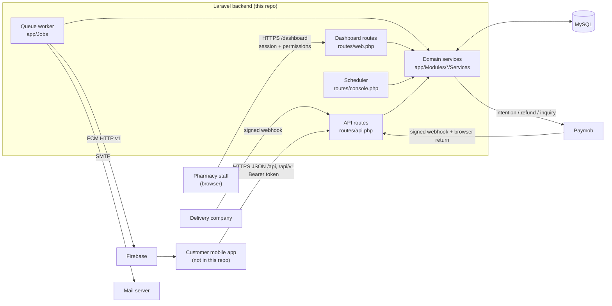
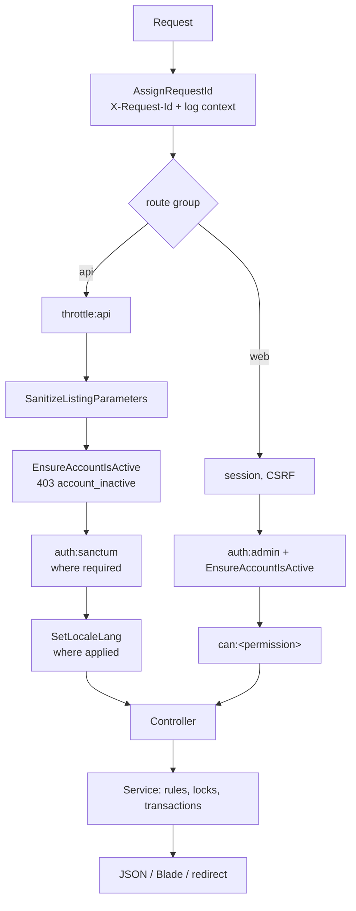

# Architecture

## 1. What this repository is

The **backend** of the Alkawthar pharmacy e-commerce system (store branding `elkawther` / Alkawthar):

* a **JSON API** for the customer mobile app (catalog, cart, checkout, orders, payments, returns,
  loyalty, health tools, notifications, contact), and
* a server-rendered **admin dashboard** (Blade, Tabler UI) for staff: orders, payments,
  refunds, delivery, catalog, inventory, purchasing, marketing, loyalty, reports, health content,
  settings, admins and roles, import/export.

The **mobile app itself is not in this repository**; it calls the API (deep-link scheme
`elkawther://`). The store sells in **Egypt only, in EGP**, on Egyptian local time (`Africa/Cairo`).

## 2. Technology

| Layer | Choice |
|---|---|
| Language / framework | PHP ^8.2 (8.4 used locally), Laravel 12 |
| Auth | Laravel Sanctum (customer bearer tokens), session guard `admin` (dashboard), Laravel UI login screens |
| Database | MySQL / MariaDB in production; SQLite in-memory for tests |
| Queue / cache / sessions | Database drivers by default (`jobs`, `cache`, file sessions); Redis supported by config |
| Dashboard UI | Blade views with self-hosted Tabler 1.6.1 (Bootstrap 5), Tabler Icons, Chart.js 4.5.1 and Tom Select 2.6.2 (`public/assets/libs`). The `jeroennoten/laravel-adminlte` package is installed but the dashboard layout (`resources/views/admin/layout.blade.php`) does not use it. |
| Spreadsheets | `openspout/openspout` (streaming CSV/XLSX) |
| Payments | Paymob (HTTP, implemented in `PaymobGateway`); cash on delivery |
| Push | Firebase Cloud Messaging HTTP v1 (no SDK), or log driver |
| Tests | PHPUnit 11 (737 tests) |

## 3. System context



## 4. Request pipeline



## 5. Module map

`app/Modules/*` groups code by feature. API controllers are prefixed `Api*`; the others serve the
dashboard.

| Module | Area | Customer API | Dashboard |
|---|---|---|---|
| `User` | Registration, OTP, login, profile, passwords | ✓ | — |
| `Customers` | Customer list/profile, activation | — | ✓ |
| `Address` | Customer addresses | ✓ | — |
| `Admin` | Admins, roles, permissions, audit log, private files | files | ✓ |
| `Product`, `Category`, `Brand`, `HealthIssue` | Catalog | ✓ (read) | ✓ |
| `Favorite`, `Rate` | Favorites, reviews | ✓ | — |
| `Cart` | Cart with promotion pricing | ✓ | — |
| `Orders` | Checkout, order workflow, returns | ✓ | ✓ |
| `Payments` | Payments, Paymob, COD, refunds, payment methods | ✓ | ✓ |
| `Delivery`, `DeliveryPrice`, `Location` | Zones, rates, providers, shipments, cities/areas | ✓ | ✓ |
| `Inventory` | Warehouses, stock, batches, transfers, counts, suppliers, purchase orders | — | ✓ |
| `Promotions`, `Discount`, `Coupon`, `FlashSale`, `Banner`, `OpeningAd` | Promotion engine and marketing | ✓ (read) | ✓ |
| `Points` | Loyalty ledger, rewards, redemptions | ✓ | ✓ |
| `HealthService`, `Medication` | Health trackers, vaccines, pregnancy, medication reminders, devices/notifications | ✓ | ✓ |
| `ContactMessage` | Customer ↔ pharmacy conversations | ✓ | ✓ |
| `Reports` | Reports and revenue rules | — | ✓ |
| `Setting` | Store settings | ✓ (read) | ✓ |
| `DataTransfer` | Import & export | — | ✓ |
| `Shared` | Base repository/request, helpers, enums | — | — |

Dependencies between modules: [module-dependencies.md](module-dependencies.md).

## 6. Key design decisions

1. **Single writers.** Each critical state has exactly one service allowed to change it:
   order status → `OrderWorkflow`; stock → `InventoryService`; payment status → `PaymentService`;
   refunds → `RefundService`; points → `LoyaltyLedger`; prices → `PromotionEngine`; shipment state →
   `OrderFulfilment`.
2. **Ledgers over balances.** Stock (`stock_movements`) and points (`loyalty_ledger`) are append-only
   ledgers; balances are projections or sums, verified daily (`inventory:verify`).
3. **Idempotent events** with unique keys; **row locks in one global order**; **deadlock retries**.
4. **Snapshots** of prices, promotions and addresses on orders.
5. **Server-side authority**: no price, total or payment state accepted from the app; online payments
   become paid only on verified provider evidence.
6. **Backward compatibility** with app versions in the field: duplicated route prefixes, legacy
   response keys kept and new keys added, legacy endpoints (`delivary_prices`, `points/*`) kept with
   their old shapes.
7. **Data-driven configuration**: payment methods, delivery zones/rates/providers, promotions, roles
   and permissions, health content and loyalty rules are database rows edited from the dashboard.

## 7. Order-to-cash at a glance

```mermaid
sequenceDiagram
  autonumber
  participant App
  participant API as Checkout API
  participant Inv as InventoryService
  participant Pay as PaymentService
  participant Paymob
  participant WF as OrderWorkflow
  participant Ship as OrderFulfilment
  App->>API: POST /api/user/orders (address, method, coupon, points)
  API->>API: lock customer, cart, sizes; price with PromotionEngine
  API->>Inv: reserve each line (gifts too)
  API->>Ship: create shipment (address orders)
  API->>Pay: create payment (COD: pending; Paymob: pending + TTL)
  API-->>App: 201 order (+ checkout_url for Paymob)
  App->>Paymob: customer pays
  Paymob->>API: signed webhook
  API->>Pay: verify HMAC + API, mark paid, project order
  Note over WF: staff confirm → picking → packed
  Ship->>WF: shipment picked_up/in_transit → on_delivery (stock fulfilled)
  Ship->>WF: delivered → completed (COD collected, points activated, coupon consumed)
```

## 8. Related documents

* [Functional documentation](functional/README.md)
* [Technical reference](technical/technical-reference.md) · [Database](technical/database.md) · [API](technical/api-reference.md)
* [Business rules](business-rules.md) · [Permissions matrix](permissions-matrix.md)
* [Testing & deployment](testing-and-deployment.md) · [Known gaps](known-gaps.md)
