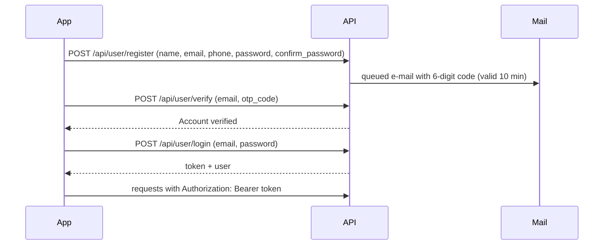

# Authentication, customers and addresses

Code: `app/Modules/User` (customer auth and profile), `app/Modules/Customers` (dashboard customer
pages), `app/Modules/Address`, `app/Http/Controllers/Auth/LoginController` (admin login),
`app/Http/Middleware/EnsureAccountIsActive`, `app/Mail/SendOtp`, `app/Mail/PasswordChanged`.
Admins and roles: [roles-and-permissions.md](../roles-and-permissions.md).

## 1. Purpose

Let customers create an account in the app, prove their e-mail, sign in with a token and manage their
profile and delivery addresses; let staff sign in to the dashboard; let admins see and block
customers.

## 2. Customer workflows

| Workflow | Steps and rules |
|---|---|
| Register | Unique e-mail and phone, password ≥ 8, `confirm_password` must match. A verification code is e-mailed. The account can sign in **before** verifying unless `REQUIRE_VERIFIED_LOGIN=true` (off by default so existing users are not locked out). |
| Verify | Code from the e-mail; 5 wrong guesses destroy it; `verify/resend` sends a new one (≤ 5 codes/hour/account; same answer whether or not the account exists). |
| Login | E-mail + password → Sanctum token (expires after `SANCTUM_EXPIRATION`, 30 days). Deactivated accounts get 403 `account_inactive`. |
| Logout | Revokes **all** of the customer's tokens (every device). |
| Profile | View (`/user/user/data`) and update name, e-mail, phone (own profile only). Changing the e-mail un-verifies the account, signs out other devices and sends a code to the new address. |
| Forgot password | `password/forgot` → code by e-mail → (optional `password/verify-otp`) → `password/reset/auth` with code and new password. Every token is revoked. |
| Change password (signed in) | `password/reset` with the new password and, when `PASSWORD_CHANGE_REQUIRES_CURRENT=true`, the current password or an e-mailed code. In the default compatibility mode a change without proof is accepted, logged as a warning and the owner is e-mailed. Other devices are signed out. |
| Addresses | Create, list, view, edit, delete, set default. Types `home`, `work`, `pharmacy`. Optional `city_id` / `area_id` (active Egyptian city and its area); without them, delivery pricing matches the governorate/city name exactly once and stores the link. |

## 3. Admin workflows

| Screen | Capability | Permission |
|---|---|---|
| `/login` | Admin sign-in (e-mail + password, "remember me"). Inactive admins cannot sign in. Public registration and password-reset screens are disabled. | — |
| Sales › Customers | List with search (name, e-mail, phone), order counts, amount spent; totals (all, new this month, with orders) | `customers.view` |
| Customer page | Profile, addresses, orders, returns, loyalty balance/owed points and ledger (with `loyalty.view`), adjust points (with `loyalty.adjust_points`), redeem a reward at the counter (with `loyalty.manage`) | `customers.view` |
| Activate / deactivate | Deactivating deletes the customer's tokens (signed out everywhere) and blocks the API with 403; reactivating restores access. Audited (`customer.activate` / `customer.deactivate`). | `customers.activate` |
| Export customers | Contact data (sensitive export, audited) | `customers.export` |

There is no dashboard function to create or edit customers, verify them by hand or reset their
password.

## 4. Data

`users` (name, phone, e-mail, password hash, `is_verified`, `is_active`, `otp_code` (hash),
`otp_expires_at`, `otp_attempts`, `social_id`, `social_provider`), `personal_access_tokens`,
`addresses`, `admins`. See [database.md](../technical/database.md).

## 5. Business rules and edge cases

* Responses never reveal whether an e-mail is registered (forgot, resend).
* OTP guesses are counted **before** comparison in one atomic UPDATE, so parallel requests cannot
  exceed 5 guesses; a correct code resets the counter.
* `isActive` / `isVerified` sent to the profile endpoint are ignored.
* An account whose `is_active` is null counts as active.
* `social_id` / `social_provider` columns exist and are returned, but **no social-login endpoint
  exists** (see [known-gaps.md](../known-gaps.md)).
* The address `type` value `pharmacy` exists in validation; pickup at checkout is selected with
  `address_id = -1`, not with an address type.

## 6. Background processing and integrations

OTP and password-changed e-mails are queued (`ShouldQueue`, encrypted) — a queue worker and a mail
server are required. Expired tokens are pruned daily (`sanctum:prune-expired`).

## 7. Security

See [technical-reference.md §7](../technical/technical-reference.md#7-security-measures): hashed OTPs,
throttling (`throttle:auth`), token revocation on password reset / e-mail change, deactivation
middleware, admin guard separation.

## 8. Dependencies

Used by every customer feature (token). Depends on Mail. Customer page depends on Orders, Returns
and Loyalty.

## 9. Tests

`tests/Feature/Api/AccountApiTest`, `AddressApiTest`, `Security/AuthenticationTest`,
`AuthHardeningTest`, `PasswordChangeTest`, `AccountActivationTest`, `RouteProtectionTest`.
