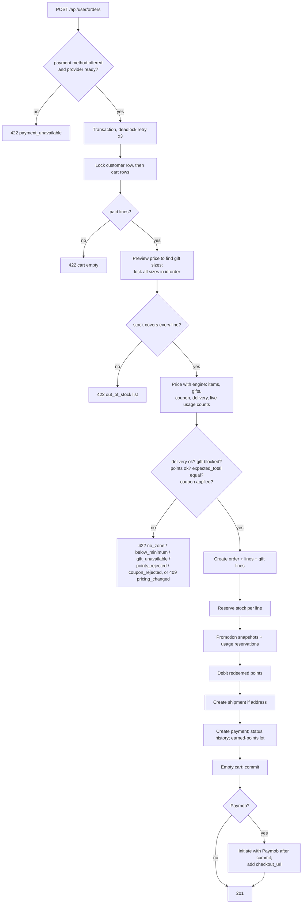

# Cart and checkout

Code: `app/Modules/Cart/CartController`, `app/Modules/Orders/Services/CheckoutService`,
`app/Modules/Orders/Requests/CheckoutRequest`, promotion services in `app/Modules/Promotions`.
Pricing rules in full: [marketing-promotions.md](../marketing-promotions.md).

## 1. Purpose

Let a customer build a cart priced exactly as checkout will price it, then turn it into an order
safely (no overselling, no double orders, no price from the app).

## 2. Cart workflow (customer)

| Action | Endpoint | Behaviour |
|---|---|---|
| View | `GET /api/user/cart` (`?coupon=`, `?address_id=`) | Re-prices every line; removes sold-out lines and lowers quantities above stock (reported in `adjustments`); syncs gift lines; returns `pricing` |
| Add | `POST /api/user/cart` | The size must belong to the product; quantity 1–1000, capped at stock; sold-out size → 400; adding a size already in the cart increases that line (one paid line per size) |
| Change quantity / size | `POST /api/user/cart/update-quantity` | `increment` / `decrement`, or switch size (merges into an existing line of that size); a sold-out line cannot be edited (400) |
| Remove | `DELETE /api/user/cart/{id}` | Gift lines cannot be removed (`422 gift_not_editable`) |
| Coupon preview | `POST /api/user/cart/apply-coupon` | Whole cart priced with the coupon; delivery included when `address_id` is sent; 400 with `code` when the coupon does not apply |
| Delivery quote | `POST /api/user/delivery/quote` | Fee for an address and the current subtotal |

Gift lines (`is_gift = true`, price 0) are added, resized and removed by the backend after every
change, as Buy X Get Y / Spend X Get Y promotions are earned or lost (`gift_changes` in responses).

## 3. Checkout workflow

Inputs: `address_id` (own address or `-1` for pickup), `payment_method` (`cod` or `paymob` when
configured), optional `coupon_code`, `notes` (≤ 225), `expected_total`, `redeem_points`,
`payment_image` (only for methods that require a receipt; none of the active ones do).

## 4. Business rules

* Every amount is recalculated from the database by the engine under row locks; stored cart prices
  are only a cache.
* **Parity:** the cart preview and checkout give the same result for the same lines, customer,
  coupon, delivery, stock and promotion state (`CartCheckoutParityTest`). With `expected_total`, any
  difference (promotion ended, price changed, last coupon use taken) refuses the order with 409.
* A coupon the customer typed must apply or nothing is ordered (`coupon_rejected`) — except when a
  better automatic offer won (`conflict_better_offer`), in which case the order goes ahead without it.
* Two customers buying the last unit: sizes are locked, so the second checkout gets 422.
* Repeated or concurrent checkouts of one cart cannot create two orders (customer + cart locks; the
  cart is emptied in the same transaction).
* Points (`redeem_points`) pay only for products, never delivery; an online payment must keep an
  amount to pay; other limits are in Loyalty › Settings ([loyalty.md](../loyalty.md)).
* Orders store a snapshot of the address, every price and every applied promotion.
* Pickup orders (`address_id = -1`) have no shipment and no delivery fee.
* A receipt uploaded for an order that is not created is deleted again.

## 5. Data written

`orders`, `order_items` (gift lines included), `order_promotions`, `promotion_redemptions`,
`coupon_redemptions` (+ legacy `coupon_user`), `flash_sale_redemptions`, `stock_reservations` +
`stock_movements` + `inventory_balances`, `shipments`, `payments` + `payment_status_histories`,
`order_status_histories`, `loyalty_ledger` (+ `loyalty_redemptions` for points used); `carts` rows
deleted.

## 6. Security

Owner-only address; size must belong to the product; prices never trusted; throttled API; Paymob
called outside the transaction.

## 7. Dependencies

Promotions, Inventory, Delivery, Payments, Loyalty, Settings.

## 8. Tests

`Orders/CheckoutTest`, `Marketing/CartCheckoutParityTest`, `Api/CartLineUniquenessTest`,
`Inventory/OutOfStockTest`, `Marketing/BuyXGetYTest`, `SpendXGetYTest`, `CouponLifecycleTest`,
concurrency races in `Feature/Concurrency` (MySQL only).
