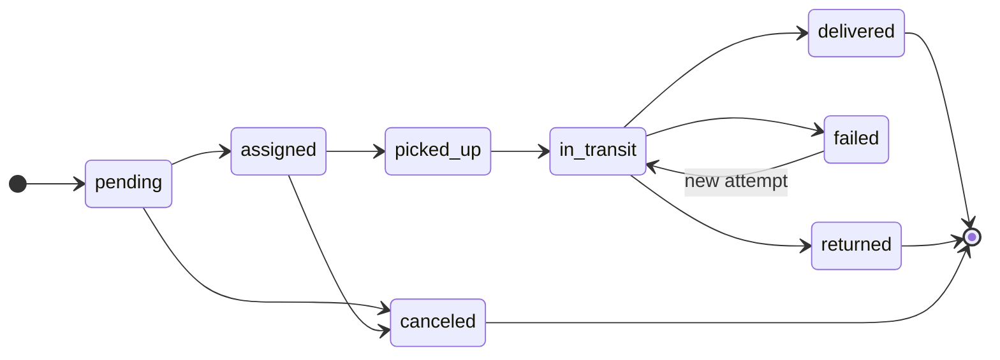

# Delivery: locations, zones, rates, providers and shipments

Code: `app/Modules/Delivery` (`Services/DeliveryQuoteService`, `Services/OrderFulfilment`,
`Providers/*`, `Admin/*`, `Api/*`), `app/Modules/DeliveryPrice` (legacy endpoint), `App\Enums\ShipmentStatus`.
Dashboard: **Delivery › Shipments / Delivery zones / Providers / Cities & areas**.

## 1. Purpose

Price delivery for an address, hand orders to a courier (own team or a company), follow the
parcel, move the order along, collect cash on delivery and bring undelivered goods back to stock
control.

## 2. Locations

Egypt only. `cities` are governorates (seeded: 27), `areas` belong to a city; both have Arabic and
English names and an active flag. Customers pick them in address forms
(`GET /api/v1/user/locations/cities`, `/areas?city_id=`). Admin (`locations.manage`): create/edit
cities and areas; import/export (`locations.import` / `.export`).

## 3. Pricing

```
address ─► city (city_id, or exact governorate/city name) ─► zone (area-specific zone wins) ─► effective rate (highest priority)
```

| Rate field | Effect |
|---|---|
| `fee` | Delivery fee |
| `free_over_amount` | Free when the items subtotal (after item promotions) reaches it |
| `min_order_amount` | Below it the order is refused (`below_minimum`) |
| `starts_at` / `ends_at`, `is_active` | Effective window (store clock) |
| `priority` | Highest wins when several rates are effective |
| `eta_min_days` / `eta_max_days` | Shown to the customer |
| `delivery_provider_id` | Optional provider of the rate |

No zone or no effective rate → `no_zone` ("city not covered"). Promotions can waive the fee (free
delivery) and coupons may discount it (`coupon_applies_to_delivery`). A zone location is unique per
(city, area). Admin (`delivery.manage_zones`): zones (name, active, locations) and their rates.
The old *Delivery prices* screen redirects to zones; each legacy `delivery_prices` row became a zone.

## 4. Providers

| Field | Meaning |
|---|---|
| `type` | Own team / company (descriptive) |
| `adapter` | `manual` (staff update shipments by hand; no webhooks) or `signed_webhook` (the company POSTs signed status updates) |
| `credentials`, `webhook_secret` | Stored encrypted (`encrypted:array` / `encrypted` casts, hidden from serialization); the secret verifies `X-Signature` |
| `tracking_url_template` | Builds the customer's tracking link |
| `supports_cod`, `is_active`, `is_default` | |
| Status maps | External status → internal `ShipmentStatus`; unmapped statuses are stored, flag the shipment and change nothing |

Admin: `delivery.manage_providers`.

## 5. Shipments

Created at checkout for address orders (fee charged, COD amount, recipient, address snapshot, zone,
rate, estimated delivery date). Pickup orders have none. Admin (`delivery.manage_shipments`):
create a shipment for an order, assign a provider (tracking number, external reference), add a status
event, settle a shipment's cash.



| Shipment status | Effect on the order / money / stock |
|---|---|
| `picked_up`, `in_transit` | Order → `on_delivery` (reserved units leave stock) |
| `delivered` | Order → `completed` directly; COD remainder collected |
| `failed` | Attempts +1, reason; COD collection failure recorded; **flagged for a person** |
| `returned` | Units come back to **quarantine**; flagged for a person |
| `canceled` | (order canceled) provider asked to withdraw; if it cannot, the shipment is flagged |

`delivered`, `returned` and `canceled` are final; a final shipment does not move again. Every event
(dashboard, webhook, poll) is an immutable `shipment_events` row with an idempotency key; repeats
change nothing. `failed` and `returned` never cancel the order by themselves.

## 6. Customer view

`GET /api/user/track-order/{id}` and order details include `delivery`: status, label, provider,
tracking number and URL, delivered/estimated dates and events.

## 7. Webhook

`POST /api/webhooks/delivery/{provider code}` — see
[api-reference.md §14](../technical/api-reference.md#post-apiwebhooksdeliveryprovider-code).

## 8. Audit

`delivery.zone.*`, `delivery.rate.*`, `delivery.provider.*`, `delivery.status_map.*`, `city.*`,
`area.*`, `shipment.create`, `shipment.assign`, `shipment.event`, `shipment.cod_settled`.

## 9. Dependencies

Orders (`OrderWorkflow`), Inventory (returned shipments), Payments (COD), Promotions (free delivery,
subtotal), Addresses.

## 10. Status / limitations

* Only the `manual` and `signed_webhook` adapters exist; no courier company API integration
  (creating shipments at a company, polling status) is implemented. `OrderFulfilment::poll()` exists
  for adapters that support `fetchStatus` — none does yet.
* Zones created from old production delivery prices with non-Egyptian names should be deactivated by
  an admin (decision D11).

## 11. Tests

`Delivery/DeliveryPricingTest`, `DeliveryWebhookTest`, `ProviderAbstractionTest`,
`ShipmentLifecycleTest`, `Payments/CodAndOrderLifecycleTest`.
