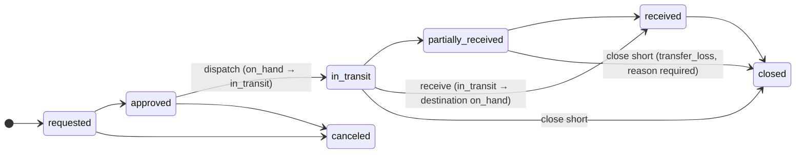

# Inventory: warehouses, stock, batches, transfers and counts

Code: `app/Modules/Inventory` (`Services/InventoryService`, `TransferService`, `StockCountService`,
`InventoryIntegrity`; controllers `InventoryController`, `WarehouseController`, `TransferController`,
`StockCountController`), models `Warehouse`, `WarehouseLocation`, `InventoryBalance`,
`InventoryBatch`, `BatchBalance`, `StockMovement`, `StockMovementBatch`, `StockReservation`,
`StockTransfer*`, `StockCount*`. Dashboard: **Inventory › Stock overview / Stock movements / Transfers
/ Stock counts / Warehouses / Inventory reports**. The stock rules table is in
[business-rules.md §1](../business-rules.md#1-stock).

## 1. Purpose

Know exactly how many sellable units of each SKU exist in each warehouse and batch, never oversell,
and keep an immutable record of why every unit moved.

## 2. Model

* **SKU** = `product_sizes` row. **Warehouse** = `warehouses` (code, name, sellable flag, active,
  default; the default sellable warehouse `MAIN` "Main warehouse" is created by migration). **Locations** (bins) can be defined per
  warehouse but balances are tracked per warehouse, not per bin.
* **Buckets** per SKU per warehouse (`inventory_balances`), split by **batch** (`batch_balances`):
  `on_hand`, `reserved` (part of on_hand held for orders), `damaged`, `quarantined`, `in_transit`.
* **Batches** (`inventory_batches`): lot number, expiry date, supplier, receipt line, unit cost. Each
  SKU has one *legacy* batch for stock from before tracking. Units leaving a bucket go
  **first-expiry-first-out (FEFO)**; dated lots are sold before undated ones.
* **Sellable stock** shown to customers (`product_sizes.stock`) = Σ (`on_hand − reserved`) over
  sellable, active warehouses and sellable batches (not expired, not inside
  `PHARMACY_MIN_SHELF_LIFE_DAYS`). `quarantined_stock` = Σ `quarantined`.
* **Ledger**: every bucket change is one immutable `stock_movements` row (type, bucket, before /
  change / after, warehouse, reference, admin or customer, reason, notes, unit cost) with its batch
  lines and a unique idempotency key.

Movement types: `opening_balance`, `initial`, `purchase_receipt`, `adjustment`, `count_correction`,
`reservation`, `reservation_release`, `fulfillment`, `gift`, `cancellation`, `cancellation_return`,
`shipment_return`, `return_quarantine`, `return_restock`, `return_damaged`, `damage`, `write_off`,
`transfer_out`, `transfer_dispatch`, `transfer_in`, `transfer_loss`, `supplier_return`, `expiry`,
`batch_reallocation` (and legacy `sale`).

## 3. Admin capabilities

| Screen | Capabilities | Permission |
|---|---|---|
| Stock overview | Per-SKU list with filters (all / out / low / ok / overstock / reserved / damaged / quarantined), warehouse, category, search by name or exact SKU/barcode (scanner), size, colour; totals (products, SKUs, on hand, available, reserved, damaged, quarantined, in transit) | `inventory.view` |
| SKU page | Balances per warehouse and batch, reservations, movements; **operations**: `adjust` (± quantity, reason), `damage` (on_hand → damaged), `write_off` (damaged out), `inspect` quarantine (restock / damaged / disposed); SKU settings (SKU, barcode, colour, cost, min/max, reorder point/quantity) | `inventory.view` + `inventory.adjust` |
| Stock movements | Ledger with filters | `inventory.view` |
| Inventory reports | Valuation by warehouse and category, reorder list, movement summary for a period, integrity problems, batches expiring within `PHARMACY_NEAR_EXPIRY_DAYS` (90), units with unknown expiry | `inventory.view` |
| Warehouses | Create/edit warehouses (sellable, active, default) and locations | `warehouses.manage` |
| Transfers | Request → approve → dispatch → receive (partial) → close (with reason for units never received) / cancel | `inventory.transfer` |
| Stock counts | Start a count for a warehouse → record counted quantities → complete (corrections) / cancel | `inventory.count` |
| Import / export stock | Adjustments from a file (set counted quantity or ± amount, with reason); export per warehouse | `inventory.import`, `inventory.export` |

Every operation requires a reason and is audited (`inventory.adjust|damage|write_off|inspect`,
`inventory.sku`, `warehouse.*`, `transfer.*`, `count.start`, `count.complete`).

## 4. Workflows

### 4.1 Order stock

| Event | Effect |
|---|---|
| Checkout | `reservation`: reserved + in the default sellable warehouse first, then others; FEFO batches |
| Dispatch (`on_delivery`) or completion | `fulfillment` (`gift` for gift lines): on_hand −, reserved − |
| Cancel before dispatch | `reservation_release` |
| Cancel after dispatch | `cancellation_return` → quarantined + |
| Shipment returned | `shipment_return` → quarantined + |
| Return accepted | `return_quarantine` → quarantined + |

### 4.2 Transfers

Source and destination must differ; received quantities cannot exceed what is in transit.

### 4.3 Stock counts

Draft → record counted quantities (whole numbers ≥ 0) → complete: each line's difference against the
on-hand **at completion** becomes a `count_correction`; a count below the units reserved for orders
is refused. Only drafts can be canceled.

### 4.4 Batch expiry

`inventory:expire-batches` (daily 00:15) moves unreserved units of expired batches from on_hand to
damaged (`expiry` movement). Batches entering the minimum shelf life stop being sold without moving.

### 4.5 Integrity

`inventory:verify` (daily 03:00, read-only) checks balances = ledger = reservations = catalog
stock; problems are logged and shown on Inventory reports.

## 5. Rules

* No bucket below zero, `reserved` never above `on_hand`, for the SKU and every batch.
* All changes lock the SKU row first (one lock order, no deadlocks); the same business event applied
  twice changes nothing.
* Quarantined units are never sold automatically; only an inspection (`return_restock`) puts them
  back on sale.
* Purchase orders never change stock; receipts do ([suppliers-and-purchasing.md](suppliers-and-purchasing.md)).

## 6. Limitations

* Balances are per warehouse, not per bin location.
* No pick lists or per-bin picking (`picking` / `packed` are order stages only).
* Valuation uses weighted average cost (updated on receipt), not FIFO cost layers.
* `PHARMACY_REQUIRE_EXPIRY_ON_RECEIPT` is off by default (nothing marks which products are medicines).

## 7. Tests

`Inventory/InventoryDomainTest`, `StockLedgerTest`, `BatchExpiryTest`, `OutOfStockTest`,
`InventoryAuditTest`, `SupplierPaymentTest`, `Database/RowLockingTest` (MySQL), concurrency races.
