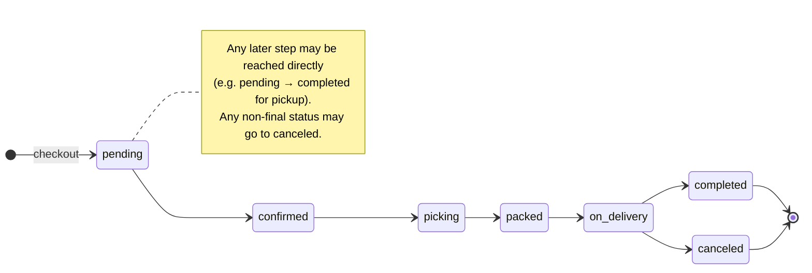

# Orders

Code: `app/Modules/Orders/OrderController`, `Services/OrderWorkflow`, `App\Enums\OrderStatus`,
`app/Modules/Delivery/Services/OrderFulfilment` (status changes from shipments and the dashboard).
Dashboard: **Sales › Orders**.

## 1. Purpose

Track every order from checkout to completion or cancellation, with exactly-once side effects on
stock, payments, points, promotions and delivery.

## 2. Status lifecycle

Rules (`OrderStatus::canTransitionTo`): statuses only move **forward** along
`pending → confirmed → picking → packed → on_delivery → completed`, and steps may be skipped;
`canceled` is reachable from any non-final status; `completed` and `canceled` are final.

**Customer view:** apps know five statuses. `picking` and `packed` are reported as `confirmed`;
the exact step is `fulfillment_stage`.

**Online orders** (Paymob) cannot move to any status other than `canceled` until the payment is
settled (`awaiting_online_payment`). Paid Paymob orders are **not** confirmed automatically; staff
confirm them (decision B2 in the implementation report).

## 3. Side effects of transitions (`OrderWorkflow::transition`)

| Transition to | Effects |
|---|---|
| `confirmed` | `confirmed_at` set (first time) |
| `on_delivery` or `completed` | Reserved units leave the warehouse (`fulfillment` / `gift` movements) — once |
| `completed` | `completed_at`; COD remainder recorded as collected (courier for address orders, counter for pickup); promotion/coupon uses **consumed**; earned points activated (default activation rule) |
| `canceled` | Reservations released (or dispatched units → quarantine); open shipments canceled (provider asked to withdraw; failure flags the shipment); points used come back and earned points are reversed; unpaid payments canceled and money already received queued for refund; promotion uses released, coupon use released when `coupon_release_on_cancel` (default on); `canceled_at` |

Every transition locks the order row, re-checks the graph under the lock, and writes
`order_status_histories` (from, to, actor type `admin|customer|provider|system`, actor id, note).

## 4. Who changes the status

| Actor | How |
|---|---|
| Admin | Order page › status (only valid next statuses are offered). `orders.update_status`; `orders.cancel` for canceling. Audited `order.status`. |
| Customer | `POST /api/user/orders/{id}/cancel` — only `pending`, only when `settings.customer_can_cancel_pending` is on (default **off**, decision D4). |
| Delivery | Shipment events: `picked_up` / `in_transit` → `on_delivery`; `delivered` → `completed` (skips straight to completed). `failed` / `returned` only flag the shipment. |
| System | `payments:expire-stale` cancels an online order left without a valid payment. |

## 5. Admin capabilities

| Screen | Capabilities | Permission |
|---|---|---|
| Orders list | Filter by status, payment status, payment method (retired methods included), search by `#id`, customer name or phone; status counts; net revenue | `orders.view` |
| Order page | Customer, address snapshot, lines (with gifts, reservations per warehouse), pricing breakdown, coupon, promotions, returns, shipments + events, status history, payments, refunds; change status; create/assign shipment; verify a legacy transfer receipt | `orders.view` (+ per action) |
| Verify legacy receipt | Paid / failed for an `awaiting_verification` payment (ZainCash / Qi Card orders placed before retirement). Online and COD payments cannot be set by hand. | `payments.verify` |
| Export orders / order lines | | `orders.export` |

Sidebar badge: pending orders.

## 6. Customer capabilities

List grouped by status, details, tracking (with delivery events), cancel (if allowed), payment
status and retry pay (Paymob), legacy points-per-order list. Orders with an **accepted return are
hidden** from the customer's lists, details and tracking (decision D3/D13) but remain in reports and
the dashboard.

## 7. Data

`orders`, `order_items`, `order_status_histories`, `order_promotions` —
[database.md §3.3](../technical/database.md#33-cart-orders-payments-refunds-returns).

## 8. Edge cases

* A double-submitted cancel restores stock once (order row lock + idempotent movements).
* A customer cancel that races a warehouse status change is refused (`onlyFrom: pending` re-checked
  under the lock).
* Past orders still show products that sold out or were deleted (snapshots).
* Completing a COD order by hand records the cash as **collected**, not settled.

## 9. Tests

`Orders/OrderStatusTest`, `OrderStateMachineAuditTest`, `OrderPoliciesTest`, `FinancialTest`,
`RemediationRulesTest`, `PointsAndHistoryTest`, `Payments/CodAndOrderLifecycleTest`,
`Delivery/ShipmentLifecycleTest`.
