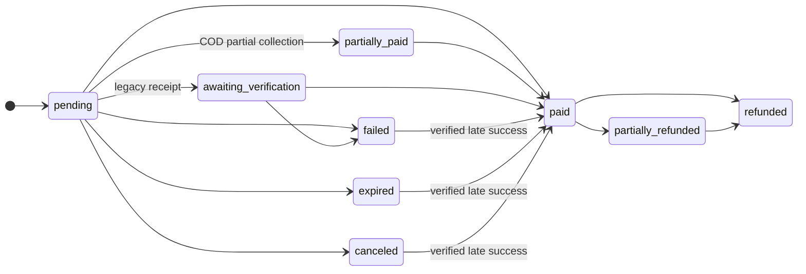

# Payments, Paymob and cash on delivery

Code: `app/Modules/Payments` (`Services/PaymentService`, `CodSettlementService`, `Gateways/*`,
`Api/ApiOrderPaymentController`, `Api/PaymentWebhookController`, `Admin/PaymentController`,
`Admin/CodController`, `PaymentMethodController`, `ApiPaymentMethodController`), `App\Enums\PaymentStatus`.
Dashboard: **Payments › Payments / Cash on delivery / Payment methods**. Refunds:
[returns-and-refunds.md](returns-and-refunds.md).

## 1. Purpose

Record every payment attempt for an order, take online payments through Paymob only on verified
provider evidence, track cash collected by couriers or at the counter, and settle that cash with the
pharmacy.

## 2. Payment methods

Payment methods are rows of `payment_methods`, all in EGP. Only two providers can be offered
(`PaymentMethod::ACTIVE_PROVIDERS`): **`cod`** (cash on delivery / at the counter) and **`paymob`**
(online, only once configured). **ZainCash and Qi Card are retired**: their rows are kept inactive
and `is_legacy`, read-only, so past orders stay readable, filterable and refundable.

| Screen action | Rules | Permission |
|---|---|---|
| List methods | Shows Paymob readiness (missing configuration keys, never the secrets) | `payments.view` |
| Create | `provider` (`cod|paymob`), `code` (unique, alpha-dash), names ar/en, account name/number, instructions ar/en, active, sort order. `requires_receipt` is always false (receipts belonged to the retired transfers). | `payment_methods.manage` |
| Edit | Provider and code cannot change. | `payment_methods.manage` |

## 3. Payment records and statuses

One `payments` row per attempt (`PAY-<ULID>` reference). `orders.payment_status` is **projected**
from the order's effective payment (the one that paid it, never a duplicate capture; else the
latest attempt).



`unpaid` is the order-level name for "no money yet" (COD before collection). Every change is
recorded in `payment_status_histories` with actor and note.

## 4. Paymob online payment

```mermaid
sequenceDiagram
  autonumber
  participant App
  participant API
  participant Paymob
  App->>API: checkout (payment_method = paymob)
  API->>API: order + payment (pending, expires in PAYMOB_PAYMENT_TTL_MINUTES)
  API->>Paymob: create intention (after commit)
  API-->>App: 201 + payment.checkout_url
  App->>Paymob: customer pays on Unified Checkout
  Paymob->>API: POST /api/webhooks/payments/paymob (HMAC)
  API->>API: store event, claim, verify HMAC
  API->>Paymob: GET transaction (PAYMOB_VERIFY_WITH_API)
  API->>API: check amount, currency, reference; mark paid; project order
  Paymob-->>App: browser → GET /payments/paymob/return (signed)
  API-->>App: redirect elkawther://payment-result?status=...
  App->>API: GET /api/user/orders/{id}/payment (poll)
```

Rules:

* **Paid only on verified evidence**: valid HMAC, and (by default) confirmation from Paymob's API;
  amount, currency and our reference must match. No admin can mark a Paymob payment paid.
* **Retry**: `POST /api/user/orders/{id}/pay` creates a new attempt for a `pending` online order that
  is not paid yet (at most 5 attempts per order). The previous attempt is canceled locally; if it is
  paid at Paymob anyway, that capture is recorded and refunded.
* **Duplicate captures** (two successful payments for one order) are recorded, flagged
  (`needs_review`) and refunded in full automatically.
* **Late payment** after the order was canceled is recorded and refunded.
* **Expiry**: `payments:expire-stale` (every 5 min) asks Paymob about each payment past
  `expires_at`; only a payment Paymob confirms unpaid is expired, and the order is canceled (stock
  released). Without an API key the job waits 30 extra minutes for a late webhook first.
* **Recovery**: events whose processing failed or died are re-applied by `payments:recover-events`
  (stale after 5 min, up to 10 attempts); stale/exhausted events are reported in the log and on the
  Payment events screen.
* An online order cannot be prepared (confirmed / picked / shipped / completed) before it is paid.
* Paymob stays unavailable at checkout and in `GET /payment-methods` until `missingConfiguration()`
  is empty (`php artisan payments:paymob-check`).

## 5. Cash on delivery

| Step | What happens |
|---|---|
| Checkout | Payment `pending`, `collection_status = pending` |
| Delivered (shipment event) | Remaining amount recorded as **collected** by the courier |
| Completed by hand / pickup | Remaining amount recorded as collected (`courier` or `counter`) |
| Admin "collect" | Records a (partial) collection: `amount`, `via` (`counter|courier`), note → `partially_paid` / `paid` |
| Failed delivery | Collection failure recorded; payment stays due |
| Settlement | **Collection is not settlement.** *Payments › Cash on delivery* lists collected-but-unsettled payments (by provider); a settlement (`CS-000123`) records the cash actually received for a set of payments, with the difference (shortfall). Single-shipment settlement is also available from Shipments. |

## 6. Admin capabilities

| Screen | Capabilities | Permission |
|---|---|---|
| Payments | List with filters (provider, status, "needs review", date range, search by reference or `#order`), totals for the period, Paymob readiness (environment, flow, missing keys), rejected events in the last 7 days, pending refunds; payment page with history, events, refunds | `payments.view` |
| Payment page actions | Record COD collection; "verify with provider" (refresh from Paymob); start a refund | `payments.collect`; `refunds.create` |
| Payment events | Provider event log (result, signature validity, attempts, errors) | `payments.view` |
| Payment reports | By provider (counts and amounts), failure reasons, COD due / collected-unsettled / settled, refunds by status and method, for a date range | `payments.view` |
| Cash on delivery | Unsettled collections, settle, settlement detail | `payments.view`, `payments.settle_cod` |
| Order page › payment status | Verify a legacy transfer receipt (paid / failed) | `payments.verify` |
| Export payments | Provider ids, payloads and receipts are never exported | `payments.export` |

Sidebar badges: payments awaiting verification, pending/failed refunds.

## 7. Data

`payment_methods`, `payments`, `payment_events`, `payment_status_histories`, `cod_settlements`,
`refunds` — [database.md](../technical/database.md#33-cart-orders-payments-refunds-returns).

## 8. Background processing

`payments:expire-stale` (5 min), `payments:recover-events` (5 min), `payments:reconcile-refunds`
(15 min). See [technical-reference.md §4](../technical/technical-reference.md#4-background-processing).

## 9. Security

HMAC verification (SHA-512), API confirmation, idempotent event processing with claims, rate limits
on webhooks, credentials only in the environment, `payments:paymob-check` never prints secrets,
locks order → payment → refund. Every manual action is audited (`payment.cod_collected`,
`payment.refresh`, `cod.settle`, `order.payment_status`, `payment_method.*`).

## 10. Status

**Paymob is implemented and covered by tests with faked HTTP, but has not been verified against a
real Paymob account.** Points to confirm with the live account are listed in
[known-gaps.md](../known-gaps.md#payments).

## 11. Tests

`Payments/PaymobTest`, `PaymentReliabilityTest`, `PaymentIntegrityAuditTest`,
`CodAndOrderLifecycleTest`, `Orders/PaymentsAndFilesTest`, `ZainCashRetirementTest`,
concurrency races (MySQL).
