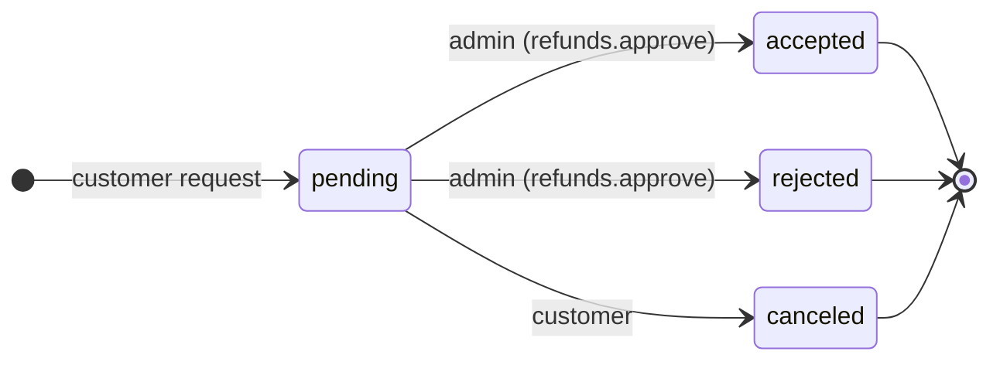
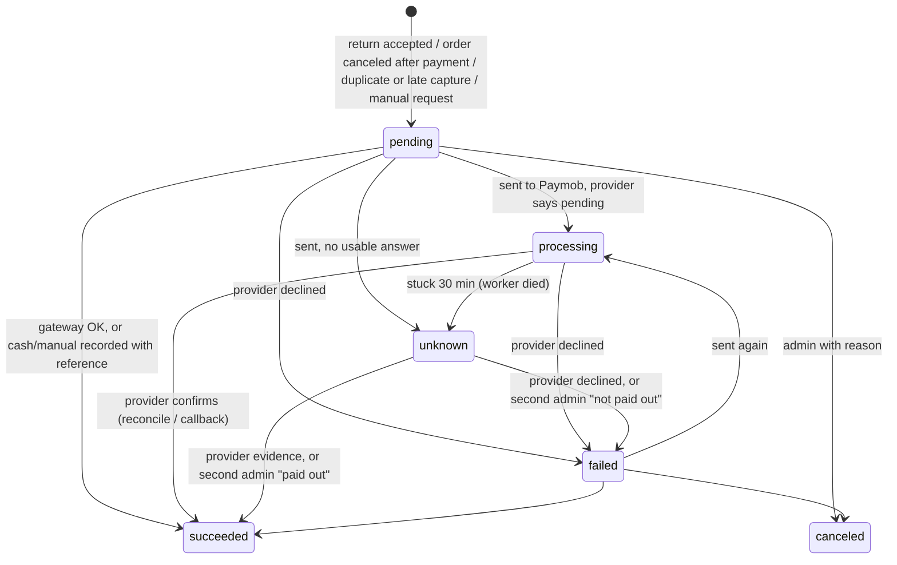

# Returns and refunds

Code: `app/Modules/Orders/ReturnRequestController`, `Services/ReturnDecisionService`,
`app/Modules/Payments/Services/RefundService`, `Admin/RefundController`,
`app/Modules/Promotions/Services/PromotionRefundPolicy`. Dashboard: **Sales › Returns**,
**Payments › Refunds**.

## 1. Purpose

Let customers ask to return delivered goods, let staff decide, put returned units into quarantine,
take back loyalty points fairly, and pay money back exactly once — online through Paymob, or in cash /
manually with a reference.

## 2. Return request lifecycle

### Customer (API)

`POST /api/user/returns` with order, reason, note, requested amount, method, address and up to 10
images (private storage). Refused when: not the caller's order (404); order canceled; no unit was
dispatched yet (cancel instead); with `settings.return_window_days` set — order not completed, or
the window has passed; the pending + accepted amounts would exceed the order total. The customer can
list, view and cancel a **pending** request (one conditional update, so a request accepted
meanwhile stays accepted).

### Admin (dashboard)

The return page shows the order lines, units already returned, images, money already refunded by
other returns, and the point reversal. **Accept** (`refunds.approve`) takes an approved amount
(default: what the customer asked) and the units actually received back per line:

1. Locks the request and the order; refuses a request already decided.
2. Refuses if accepted refunds would exceed the order total, if a quantity is not a whole number,
   belongs to another order, exceeds what was ordered, or the line was never dispatched.
3. For orders priced by the promotion engine, caps the amount with `PromotionRefundPolicy`
   (paid value of returned units − gifts/discounts no longer earned + delivery when everything paid
   comes back); the error message shows the breakdown.
4. Records the decision (`approved_amount`, `decided_by`, `decided_at`).
5. Puts each received unit into **quarantine** (`return_quarantine` movement). Returned stock is
   **never** sold again automatically; staff inspect it (Inventory › SKU › inspect: restock, damaged,
   dispose). Returned gift lines are marked `gift_status = returned`.
6. Reverses loyalty points in proportion to the money refunded (decision D2, one
   `loyalty_point_reversals` row) and gives back, in the same proportion, points the customer paid
   with.
7. Creates a **pending refund** for the approved amount against the payment that received the money
   (refused if no money was received — e.g. unpaid COD).

**Reject** takes an optional reason. Both are audited (`return.accept`, `return.reject`).

After acceptance the order is hidden from the customer's order lists (D3), revenue drops by the
refunded amount once the refund succeeds, and further partial returns of the same order remain
possible up to what was paid.

## 3. Refund lifecycle

| Action | Rules | Permission |
|---|---|---|
| Create on a payment | Amount ≤ refundable − open refunds; reason required | `refunds.create` |
| Process (pay out) | Only `pending` or `failed`. **Dual control** (`PHARMACY_REFUND_DUAL_CONTROL=true`): the admin who requested it cannot process it. Gateway refunds call Paymob outside the transaction; cash refunds are recorded; manual refunds require an external reference. Never more than still refundable on the payment (in-flight refunds counted). | `refunds.process` |
| Reconcile | Ask Paymob about an `unknown` / `processing` refund: provider refund transaction → succeeded / failed / unchanged; otherwise the payment's refunded total, as positive evidence only. An unknown refund is **never** resent automatically. | `refunds.process` |
| Resolve | A second admin records from Paymob's dashboard that an unknown refund was paid out or not (note required) | `refunds.process` |
| Cancel | Only `pending` or `failed` refunds; reason required | `refunds.process` |

On success (`markSucceeded`, exactly once): the refund, the payment (`refunded_amount`, status
`partially_refunded` / `refunded`) and the order (`refunded_amount`, `refund_status`) are updated.
Refunds made directly in Paymob's dashboard arrive as callbacks and are recorded.

## 4. Data

`return_requests`, `return_request_items`, `return_request_images`, `refunds`,
`loyalty_point_reversals`, plus `stock_movements` (quarantine) and `loyalty_ledger` entries.

## 5. Background processing

`payments:reconcile-refunds` every 15 minutes: refunds `processing` for 30 minutes without an answer
become `unknown`; unknown/processing refunds are reconciled with Paymob.

## 6. Security and audit

`refunds.view` to see, `refunds.approve` to decide returns, `refunds.create` / `refunds.process` for
money; dual control; return images private (owner API route, `refunds.view` dashboard route, signed
links). Audited: `return.accept`, `return.reject`, `refund.request`, `refund.process`,
`refund.reconcile`, `refund.resolve`, `refund.cancel`.

## 7. Dependencies

Orders, Inventory (quarantine), Loyalty, Promotions (refund policy), Payments/Gateways, Reports
(revenue).

## 8. Edge cases

* Two admins accepting at once: the second is refused ("already processed").
* Returns accepted before refunds existed were migrated as succeeded refunds (history unchanged).
* A return needs units that left the warehouse; an order still being prepared must be canceled.
* Points already spent cannot be taken back: the shortfall is recorded and shown as *owed*; it is not
  offset automatically against future points.

## 9. Tests

`Returns/ReturnQuarantineAndPointsTest`, `Marketing/PromotionReturnsTest`,
`Payments/PaymentReliabilityTest`, `PaymentIntegrityAuditTest`, `Orders/FinancialTest`.
