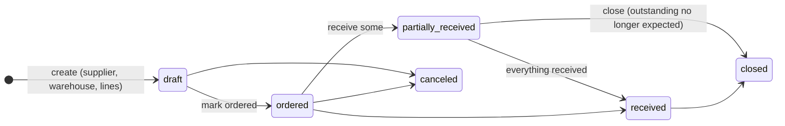

# Suppliers and purchasing

Code: `app/Modules/Inventory/SupplierController`, `PurchaseOrderController`,
`Services/PurchasingService`; models `Supplier`, `PurchaseOrder(Item)`, `PurchaseReceipt(Item)`,
`SupplierInvoice`, `SupplierPayment`, `SupplierReturn(Item)`. Dashboard: **Purchasing › Purchase orders /
Suppliers**.

## 1. Purpose

Buy stock from suppliers, receive it into a warehouse with lot and expiry information, and keep the
money owed to each supplier straight (invoices, payments, return credits).

## 2. Suppliers

Fields: code (unique), name, contact name, phone, e-mail, address, tax number, currency, payment terms
(days), notes, active. Admin: create/edit (`suppliers.manage`), import/export (`suppliers.import` /
`.export`; invoices, payments and balances are never imported). The supplier page shows purchase
orders, invoices, payments, returns and the **balance**:

> balance = Σ invoices − Σ payments − Σ credit of **dispatched** supplier returns

A negative balance is a credit (e.g. after an advance payment).

## 3. Purchase orders

* Lines: product size, quantity ≥ 1, unit cost; the same size cannot appear twice. Totals: subtotal,
  tax, shipping, total. Reference `PO-000123`.
* **A purchase order never changes stock.** Only receipts do.
* Permissions: `purchase_orders.manage` (create, order, close, cancel), `purchase_orders.receive`
  (receive).

### Receiving (goods receipt `GRN-000123`)

* Only `ordered` / `partially_received` orders can be received; partial receipts are allowed;
  receiving more than is outstanding on a line is refused.
* Per line: units received, units damaged, optional lot number and expiry date. Good units go to
  `on_hand` of the order's warehouse in that batch (`purchase_receipt` movement); damaged units go to
  `damaged`. A lot already expired is refused. With `PHARMACY_REQUIRE_EXPIRY_ON_RECEIPT=true` an
  expiry date is required on every line.
* The SKU's **weighted average cost** is updated with the good units.
* Optional supplier invoice number and notes on the receipt.

## 4. Supplier finance (`supplier_finance.manage`)

| Record | Rules |
|---|---|
| Invoice | number (unique per supplier), invoice date, due date ≥ invoice date, amount > 0, optional purchase order, notes |
| Payment | amount > 0, paid on (≤ today), method, reference, notes, optional invoice. Against an invoice: never more than is left on it. On account: never more than the supplier is owed, unless **advance payment** is ticked and `PHARMACY_SUPPLIER_ADVANCE_PAYMENTS=true` (then recorded with `is_advance`). Decided under the supplier row lock; a resubmitted form (same `request_key`) returns the payment already recorded. |
| Return | warehouse, reason, lines (size, quantity, source bucket `on_hand|damaged|quarantined`, unit cost) → draft `SR-000123`; **dispatch** takes the units out (`supplier_return` movement) and counts its credit; only drafts can be canceled |

## 5. Audit

`supplier.create`, `supplier.update`, `supplier.invoice`, `supplier.payment`, `supplier.return`,
`supplier.return_dispatch`, `purchase_order.create|ordered|receive|close|cancel`.

## 6. Limitations

* No three-way matching of invoices with receipts; no approval step for supplier payments.
* There is no separate approval step: marking a draft "ordered" records that admin as `approved_by`.

## 7. Tests

`Inventory/InventoryDomainTest`, `SupplierPaymentTest`, `BatchExpiryTest`, `DataTransfer/ImportExportTest`.
