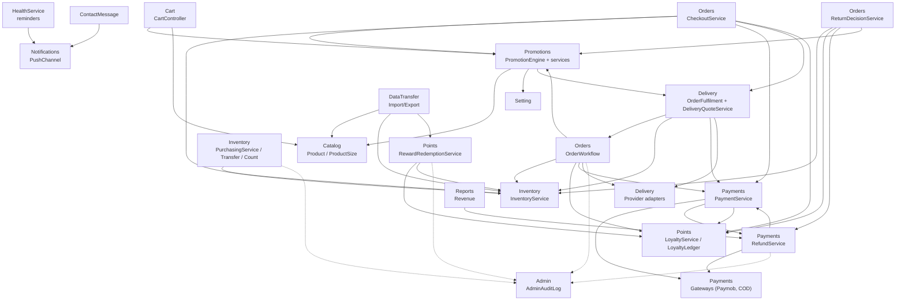

# Module dependency overview

Which module calls which, and why. Arrows point from the caller to the module it depends on. Built
from the service constructors and the calls inside `CheckoutService`, `OrderWorkflow`,
`OrderFulfilment`, `PaymentService`, `RefundService`, `ReturnDecisionService`, `LoyaltyService` and
`RewardRedemptionService`.

## 1. Service-level graph

Dotted arrows: audit-log writes (many dashboard controllers also write audit entries directly).

## 2. Who depends on whom (table)

| Module | Depends on | Used by |
|---|---|---|
| **Catalog** (Product, Category, Brand, HealthIssue) | Promotions (display price via `Product::priceForSize`), Inventory (stock projection read) | Cart, Checkout, Promotions, Inventory, Import/Export, Loyalty rewards, Reports |
| **Cart** | Promotions (`CartPricingService`, `CartPromotionSync`, `CouponEvaluator`), Catalog, Delivery (quote in preview) | Checkout (reads and empties the cart) |
| **Promotions** (engine, discounts, flash sales, coupons, campaigns) | Catalog, Settings (`coupon_applies_to_delivery`, `coupon_release_on_cancel`), Delivery (fee), Orders (usage counts) | Catalog display, Cart, Checkout, Orders (release/consume), Returns (refund policy), Marketing dashboard |
| **Orders: checkout** | Promotions, Inventory, Payments, Delivery, Loyalty, Settings | API |
| **Orders: workflow** | Inventory, Loyalty, Payments, Promotions, Delivery provider adapters | Dashboard, customer cancel, Delivery (shipment events), Payments (expiry cancels the order) |
| **Orders: returns** | Inventory (quarantine), Loyalty (reversal, restore), Payments/Refunds, Promotions (refund policy), Settings (return window) | API, Dashboard |
| **Payments** | Gateways (Paymob, COD), Refunds, Loyalty (activation "once paid"), Orders (projection, cancel on expiry) | Checkout, Workflow, Delivery (COD collection), Dashboard, webhooks, scheduler |
| **Refunds** | Payments, Gateways | Returns, Workflow (cancel of paid order), Payments (duplicate/late captures), Dashboard, scheduler, Reports (revenue) |
| **Delivery** | Orders workflow, Inventory (returned shipments), Payments (COD), provider adapters, Locations | Checkout (quote + shipment), Cart (preview), Dashboard, webhooks |
| **Inventory** | Catalog (`product_sizes`), Warehouses, Batches | Checkout, Workflow, Delivery, Returns, Purchasing, Loyalty rewards (product fulfilment), Import/Export, Dashboard, scheduler |
| **Purchasing** | Inventory, Suppliers | Dashboard, Import (suppliers) |
| **Loyalty** | Settings (`loyalty_*`), Orders, Inventory (product rewards) | Checkout, Workflow, Payments, Returns, Customers page, API, scheduler, Reports |
| **Health services** | Settings (reminder switches), StoreClock, Notifications | API, Dashboard, scheduler |
| **Notifications** | `PushGateway` (FCM or log), Laravel database notifications | Health reminders, Contact replies |
| **Contact messages** | Notifications | API, Dashboard |
| **Import / Export** | Catalog, Inventory, Purchasing, Locations, Loyalty rewards, Orders/Payments/Refunds/Customers (export only), Admin (permissions, audit) | Dashboard |
| **Reports** | Orders, Refunds (`Revenue`), Loyalty ledger, Shipments, Payments | Dashboard home, Orders list, Reports page |
| **Admin / RBAC** | — | Every dashboard route (Gates), audit log for every module |
| **Settings** | — | Promotions, Loyalty, Orders (cancel/returns), Health reminders, Inventory (low stock), API |

## 3. Side effects of order events

What each order event triggers across modules (all inside the order's transaction unless noted):

| Event | Inventory | Payments | Loyalty | Promotions | Delivery |
|---|---|---|---|---|---|
| Checkout | reserve each line (gifts too) | create payment (COD pending / Paymob pending + TTL); Paymob initiated after commit | earned lot (`pending` or `active`); points spent at checkout debited | reserve promotion, flash-sale and coupon uses | shipment created (address orders) |
| Paid (Paymob) | — | payment `paid`, order projected; other open attempts canceled | lot activated if activation = paid | — | — |
| `on_delivery` / `completed` | reservations fulfilled (on_hand −) | completion collects COD remainder | completion activates lot (default) | completion consumes uses | — |
| Shipment delivered | (via completed) | COD collected | (via completed) | (via completed) | shipment `delivered` |
| Canceled before dispatch | reservations released | unpaid payments canceled; received money → refund request | spent points restored; earned lot voided/reversed | uses released (coupon per setting) | open shipments canceled (provider asked to withdraw) |
| Canceled after dispatch | units → quarantine | as above | as above | as above | as above |
| Shipment returned | units → quarantine | — | — | — | flagged for attention |
| Return accepted | received units → quarantine | refund request (pending) | proportional reversal (D2); proportional restore of spent points | refund policy caps the amount | — |
| Online payment expired | reservations released (order canceled) | payment `expired` | as cancel | as cancel | as cancel |

## 4. Shared infrastructure every module uses

`App\Support\Money`, `StoreClock`, `DocumentNumber`, `PrivateFiles`; `AdminAuditLog::record()`;
`Setting::current()`; `api_trans()` / `api_locale()` helpers; `Country::default()`.
