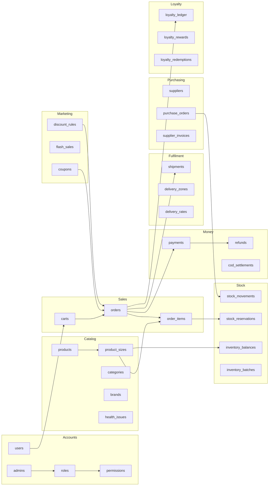
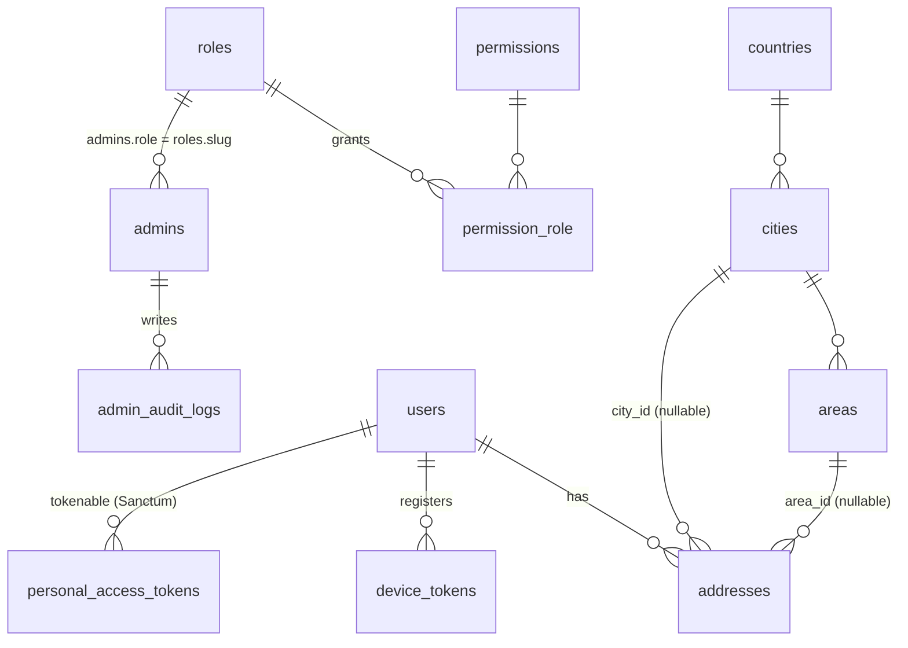
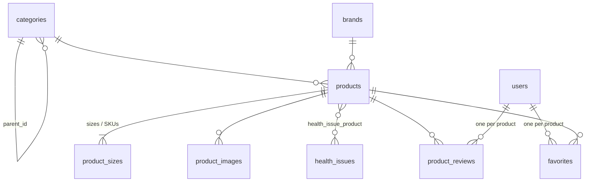
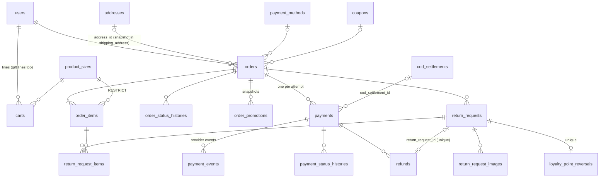
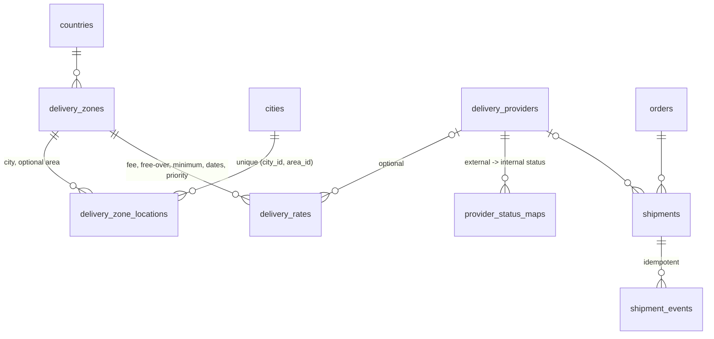
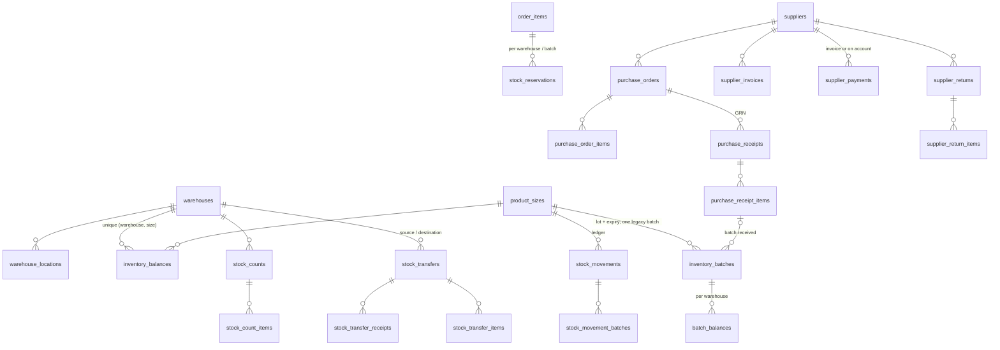
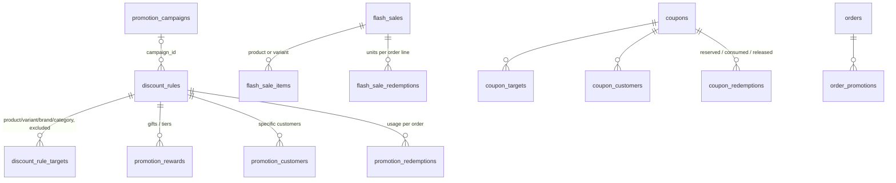
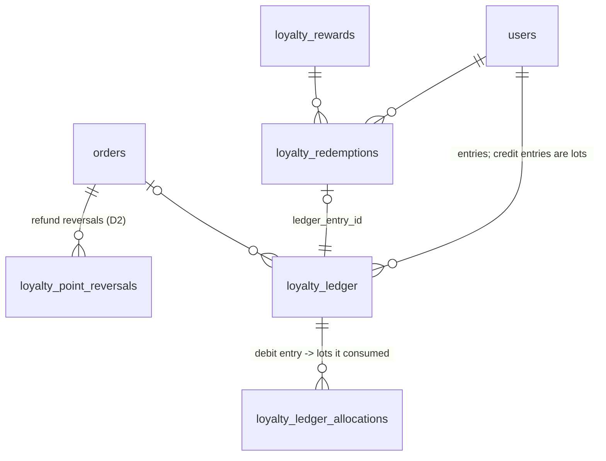
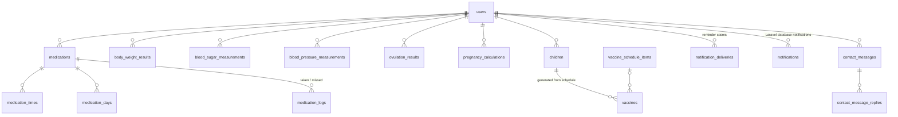

# Database reference

The schema produced by the 83 migrations in `database/migrations` (latest:
`2026_11_14_000002_drop_emailed_to_from_contact_message_replies`). Production runs on **MySQL /
MariaDB**; the test suite runs the same migrations on SQLite.

> **How this file was produced.** The table catalogue in section 4 was generated by running every
> migration on an empty SQLite database and reading the resulting schema, so column names, nullability,
> defaults, foreign keys and indexes are exactly what the migrations create. SQLite reports types in
> its own vocabulary: `string` = `VARCHAR`, `decimal` = `DECIMAL(p,s)` (money columns are
> `DECIMAL(10,2)` on MySQL), `bool` = `TINYINT(1)`, `text` = `TEXT`/`JSON` (JSON columns are cast to
> arrays by the models). Regenerate it after adding migrations (see
> [testing-and-deployment.md](../testing-and-deployment.md#5-regenerating-generated-reference-sections)).

## 1. Conventions

| Topic | Rule |
|---|---|
| Money | `DECIMAL(10,2)` in EGP. All arithmetic in integer minor units (piastres) through `App\Support\Money` (`toMinor`, `fromMinor`), rounding half up to 0.01. No amount sent by the app is trusted. |
| Time | `config/app.php` timezone is `UTC`; `created_at` etc. are UTC. Promotion, coupon and flash-sale dates are **store wall-clock times** (`Africa/Cairo`) compared with `App\Support\StoreClock::now()`. Reports group by the store's local day (`Revenue` builds a DST-aware SQL expression). |
| Document numbers | `App\Support\DocumentNumber`: row created with a temporary reference, then renamed from its id (`PREFIX-000042`). Prefixes: `PO` purchase order, `GRN` goods receipt, `TR` transfer, `CNT` stock count, `SR` supplier return, `RF` refund, `CS` COD settlement. Loyalty redemptions use `RDM-000123`; product codes `PRD-000123`; payments `PAY-<ULID>`. |
| Idempotency | Business events carry a unique key column so repeating them is a no-op: `stock_movements.idempotency_key`, `loyalty_ledger.idempotency_key`, `loyalty_redemptions.idempotency_key`, `payment_events.idempotency_key`, `shipment_events.idempotency_key`, `supplier_payments.request_key`, `notification_deliveries (type, reference_type, reference_id, occurrence)`. |
| Immutable history | Rows never updated/deleted by the application: `stock_movements`, `order_status_histories`, `payment_status_histories`, `shipment_events`, `order_promotions`, `loyalty_point_reversals`, `admin_audit_logs` (model throws on update/delete), and the core fields of `loyalty_ledger` (model guard). |
| Soft deletes | `products`, `discount_rules`, `coupons`, `promotion_campaigns`, `loyalty_rewards`, `vaccine_schedule_items` (`deleted_at`). |
| Financial FKs | Foreign keys from financial history (`orders`, `order_items`, `payments`, `refunds`, `stock_*`, `loyalty_*`) are `RESTRICT`, so history cannot be deleted by cascade (migration `2026_11_03_000004_protect_financial_history_foreign_keys`). |
| Projections | `product_sizes.stock` (= Σ `on_hand − reserved` over sellable warehouses and sellable batches) and `product_sizes.quarantined_stock` are written only by `InventoryService`. `orders.payment_status` is projected by `PaymentService::projectOrder`; `orders.refund_status` / `refunded_amount` by `RefundService::projectOrder`. Loyalty balance has **no column**: it is Σ of the ledger. |
| Single-row tables | `settings` (one row; `Setting::current()` reads the oldest and creates it if missing). |
| Egypt only | `countries` holds one row (Egypt, `EG`, `EGP`, `Africa/Cairo`, default). Orders record `country_id` and `currency_code` at checkout. |

## 2. Domain overview

## 3. Relationship diagrams

### 3.1 Accounts, access and audit

### 3.2 Catalog

### 3.3 Cart, orders, payments, refunds, returns

### 3.4 Delivery

### 3.5 Inventory and purchasing

### 3.6 Marketing and promotions

### 3.7 Loyalty

### 3.8 Health services and notifications

## 3.9 Legacy and compatibility tables / columns

| Item | Status |
|---|---|
| `delivery_prices` | **Legacy.** Kept for reference; checkout prices delivery through zones and rates. Each row was migrated into a zone (`delivery_zones.legacy_delivery_price_id`). `GET /api/v1/user/delivary_prices` now returns zones in the old row shape. |
| `coupon_user` | **Legacy** per-customer coupon history. `PromotionLifecycle` still writes a row when a coupon use is reserved (and deletes it when the use is released) so older readers keep working; the per-customer limit uses the larger of it and `coupon_redemptions`. The source of truth for uses is `coupon_redemptions`. |
| `media` | Polymorphic media table from the original skeleton. No current code path was found writing to it. |
| `products.saleable_type/saleable_id` | Original polymorphic sale link (`Product::saleable()`, eager-loaded; `FlashSale` morphs one product). `StoreProductRequest` still accepts it. Prices do not come from it: flash sales apply through `flash_sale_items` and the promotion engine. |
| `products.rate` | Average review rate, recomputed when a review is saved. |
| `orders.gift_description`, `orders.gift_rule_id`, `orders.discount_amount` | Kept for older apps; the full pricing breakdown is in the newer columns and `pricing_snapshot`. |
| `orders.points_status` | Legacy per-order points status; the loyalty ledger is the source of truth. |
| `settings.keycard` | Retired Qi Card setting (column kept). `settings.zaincash` was removed by `2026_11_05_000001_remove_zaincash_settings`; the API still returns `zaincash: null`. |
| `payment_methods` rows `zaincash`, `keycard` | Retired (`is_active = 0`, `is_legacy = 1`); history only. |
| `stock_movements` rows with `warehouse_id = null` and bucket `sellable` / `quarantine` | Written before warehouses existed; the migration added `opening_balance` rows so the ledger sums to the balances. |

## 4. Table catalogue

114 tables, grouped by domain.

### Accounts & access

#### `users`

| Column | Type | Null | Default | Reference |
|---|---|---|---|---|
| `id` | int | no |  | primary key |
| `name` | string | no |  |  |
| `phone` | string | yes |  |  |
| `email` | string | no |  |  |
| `password` | string | yes |  |  |
| `social_id` | string | yes |  |  |
| `social_provider` | string | yes |  |  |
| `is_verified` | bool | no | `0` |  |
| `otp_code` | string | yes |  |  |
| `otp_expires_at` | datetime | yes |  |  |
| `created_at` | datetime | yes |  |  |
| `updated_at` | datetime | yes |  |  |
| `is_active` | bool | no | `1` |  |
| `otp_attempts` | int | no | `0` |  |

Unique: (email)  

#### `admins`

| Column | Type | Null | Default | Reference |
|---|---|---|---|---|
| `id` | int | no |  | primary key |
| `name` | string | no |  |  |
| `phone` | string | yes |  |  |
| `email` | string | no |  |  |
| `password` | string | no |  |  |
| `remember_token` | string | yes |  |  |
| `created_at` | datetime | yes |  |  |
| `updated_at` | datetime | yes |  |  |
| `role` | string | no | `super_admin` | → `roles.slug` (on delete restrict) |
| `is_active` | bool | no | `1` |  |

Unique: (email)  
Indexes: (role)

#### `roles`

| Column | Type | Null | Default | Reference |
|---|---|---|---|---|
| `id` | int | no |  | primary key |
| `slug` | string | no |  |  |
| `name` | string | no |  |  |
| `description` | string | yes |  |  |
| `is_system` | bool | no | `0` |  |
| `is_super_admin` | bool | no | `0` |  |
| `is_active` | bool | no | `1` |  |
| `created_at` | datetime | yes |  |  |
| `updated_at` | datetime | yes |  |  |

Unique: (name), (slug)  
Indexes: (is_active)

#### `permissions`

| Column | Type | Null | Default | Reference |
|---|---|---|---|---|
| `id` | int | no |  | primary key |
| `slug` | string | no |  |  |
| `name` | string | no |  |  |
| `module` | string | no |  |  |
| `description` | string | yes |  |  |
| `is_active` | bool | no | `1` |  |
| `created_at` | datetime | yes |  |  |
| `updated_at` | datetime | yes |  |  |

Unique: (slug)  
Indexes: (module)

#### `permission_role`

| Column | Type | Null | Default | Reference |
|---|---|---|---|---|
| `id` | int | no |  | primary key |
| `role_id` | int | no |  | → `roles.id` (on delete cascade) |
| `permission_id` | int | no |  | → `permissions.id` (on delete cascade) |
| `created_at` | datetime | yes |  |  |
| `updated_at` | datetime | yes |  |  |

Unique: (role_id, permission_id)  
Indexes: (permission_id)

#### `admin_audit_logs`

| Column | Type | Null | Default | Reference |
|---|---|---|---|---|
| `id` | int | no |  | primary key |
| `admin_id` | int | yes |  | → `admins.id` (on delete set null) |
| `action` | string | no |  |  |
| `subject_type` | string | yes |  |  |
| `subject_id` | int | yes |  |  |
| `changes` | text | yes |  |  |
| `ip` | string | yes |  |  |
| `created_at` | datetime | yes |  |  |
| `user_agent` | string | yes |  |  |

Indexes: (admin_id, created_at), (action), (subject_type, subject_id)

#### `personal_access_tokens`

| Column | Type | Null | Default | Reference |
|---|---|---|---|---|
| `id` | int | no |  | primary key |
| `tokenable_type` | string | no |  |  |
| `tokenable_id` | int | no |  |  |
| `name` | string | no |  |  |
| `token` | string | no |  |  |
| `abilities` | text | yes |  |  |
| `last_used_at` | datetime | yes |  |  |
| `expires_at` | datetime | yes |  |  |
| `created_at` | datetime | yes |  |  |
| `updated_at` | datetime | yes |  |  |

Unique: (token)  
Indexes: (tokenable_type, tokenable_id)

#### `device_tokens`

| Column | Type | Null | Default | Reference |
|---|---|---|---|---|
| `id` | int | no |  | primary key |
| `user_id` | int | no |  | → `users.id` (on delete cascade) |
| `token` | string | no |  |  |
| `token_hash` | string | no |  |  |
| `platform` | string | no |  |  |
| `locale` | string | yes |  |  |
| `last_used_at` | datetime | yes |  |  |
| `created_at` | datetime | yes |  |  |
| `updated_at` | datetime | yes |  |  |

Unique: (token_hash)  

### Locations & settings

#### `countries`

| Column | Type | Null | Default | Reference |
|---|---|---|---|---|
| `id` | int | no |  | primary key |
| `iso2` | string | no |  |  |
| `name_ar` | string | no |  |  |
| `name_en` | string | no |  |  |
| `currency_code` | string | no |  |  |
| `timezone` | string | no |  |  |
| `phone_code` | string | no |  |  |
| `week_start` | string | no | `saturday` |  |
| `is_active` | bool | no | `1` |  |
| `is_default` | bool | no | `0` |  |
| `created_at` | datetime | yes |  |  |
| `updated_at` | datetime | yes |  |  |

Unique: (iso2)  

#### `cities`

| Column | Type | Null | Default | Reference |
|---|---|---|---|---|
| `id` | int | no |  | primary key |
| `name` | string | no |  |  |
| `created_at` | datetime | yes |  |  |
| `updated_at` | datetime | yes |  |  |
| `country_id` | int | yes |  | → `countries.id` (on delete set null) |
| `name_ar` | string | yes |  |  |
| `name_en` | string | yes |  |  |
| `is_active` | bool | no | `1` |  |

#### `areas`

| Column | Type | Null | Default | Reference |
|---|---|---|---|---|
| `id` | int | no |  | primary key |
| `name` | string | no |  |  |
| `city_id` | int | no |  | → `cities.id` (on delete no action) |
| `created_at` | datetime | yes |  |  |
| `updated_at` | datetime | yes |  |  |
| `name_ar` | string | yes |  |  |
| `name_en` | string | yes |  |  |
| `is_active` | bool | no | `1` |  |

#### `addresses`

| Column | Type | Null | Default | Reference |
|---|---|---|---|---|
| `id` | int | no |  | primary key |
| `user_id` | int | yes |  | → `users.id` (on delete cascade) |
| `address` | string | yes |  |  |
| `governorate` | string | no |  |  |
| `city` | string | no |  |  |
| `street` | string | no |  |  |
| `building` | string | yes |  |  |
| `apartment` | string | yes |  |  |
| `landmark` | string | yes |  |  |
| `type` | string | no | `home` |  |
| `is_default` | bool | no | `0` |  |
| `created_at` | datetime | yes |  |  |
| `updated_at` | datetime | yes |  |  |
| `city_id` | int | yes |  | → `cities.id` (on delete set null) |
| `area_id` | int | yes |  | → `areas.id` (on delete set null) |

#### `settings`

| Column | Type | Null | Default | Reference |
|---|---|---|---|---|
| `id` | int | no |  | primary key |
| `privacy_policy_ar` | text | yes |  |  |
| `privacy_policy_en` | text | yes |  |  |
| `terms_conditions_ar` | text | yes |  |  |
| `terms_conditions_en` | text | yes |  |  |
| `facebook` | string | yes |  |  |
| `instagram` | string | yes |  |  |
| `tiktok` | string | yes |  |  |
| `youtube` | string | yes |  |  |
| `phone_number` | string | yes |  |  |
| `spend_x` | string | yes |  |  |
| `get_y` | string | yes |  |  |
| `map_location_url` | string | yes |  |  |
| `keycard` | string | yes |  |  |
| `points_validity_days` | int | yes |  |  |
| `created_at` | datetime | yes |  |  |
| `updated_at` | datetime | yes |  |  |
| `low_stock_threshold` | int | yes |  |  |
| `return_window_days` | int | yes |  |  |
| `customer_can_cancel_pending` | bool | no | `0` |  |
| `coupon_applies_to_delivery` | bool | no | `1` |  |
| `vaccine_reminders_enabled` | bool | no | `1` |  |
| `medication_reminders_enabled` | bool | no | `0` |  |
| `coupon_release_on_cancel` | bool | no | `1` |  |
| `loyalty_enabled` | bool | no | `1` |  |
| `points_never_expire` | bool | no | `0` |  |
| `loyalty_min_order_amount` | decimal | no | `0` |  |
| `loyalty_max_points_per_order` | int | yes |  |  |
| `loyalty_earn_basis` | string | no | `subtotal` |  |
| `loyalty_earn_on_shipping` | bool | no | `0` |  |
| `loyalty_discounts_reduce_points` | bool | no | `0` |  |
| `loyalty_earn_on_cod` | bool | no | `1` |  |
| `loyalty_activation` | string | no | `completed` |  |
| `loyalty_point_value` | decimal | no | `0` |  |
| `loyalty_min_redeem_points` | int | no | `0` |  |
| `loyalty_max_redeem_points_per_order` | int | yes |  |  |
| `loyalty_combine_with_discounts` | bool | no | `1` |  |
| `loyalty_allow_partial_redemption` | bool | no | `1` |  |
| `loyalty_allow_multiple_redemptions` | bool | no | `1` |  |
| `loyalty_expiry_warning_days` | int | no | `7` |  |
| `loyalty_redemption_validity_days` | int | yes | `30` |  |
| `health_settings` | text | yes |  |  |

### Catalog

#### `products`

| Column | Type | Null | Default | Reference |
|---|---|---|---|---|
| `id` | int | no |  | primary key |
| `name_ar` | string | no |  |  |
| `name_en` | string | no |  |  |
| `description_ar` | text | yes |  |  |
| `description_en` | text | yes |  |  |
| `rate` | float | no | `0` |  |
| `image` | string | no |  |  |
| `brand_id` | int | yes |  | → `brands.id` (on delete set null) |
| `category_id` | int | yes |  | → `categories.id` (on delete set null) |
| `saleable_type` | string | yes |  |  |
| `saleable_id` | int | yes |  |  |
| `created_at` | datetime | yes |  |  |
| `updated_at` | datetime | yes |  |  |
| `deleted_at` | datetime | yes |  |  |
| `code` | string | yes |  |  |

Unique: (code)  
Indexes: (saleable_type, saleable_id)

#### `product_sizes`

| Column | Type | Null | Default | Reference |
|---|---|---|---|---|
| `id` | int | no |  | primary key |
| `product_id` | int | no |  | → `products.id` (on delete cascade) |
| `size` | string | no |  |  |
| `price` | decimal | no |  |  |
| `stock` | int | no | `0` |  |
| `created_at` | datetime | yes |  |  |
| `updated_at` | datetime | yes |  |  |
| `quarantined_stock` | int | no | `0` |  |
| `sku` | string | yes |  |  |
| `barcode` | string | yes |  |  |
| `color` | string | yes |  |  |
| `cost_price` | decimal | yes |  |  |
| `min_stock` | int | yes |  |  |
| `max_stock` | int | yes |  |  |
| `reorder_point` | int | yes |  |  |
| `reorder_quantity` | int | yes |  |  |

Unique: (barcode), (sku)  

#### `product_images`

| Column | Type | Null | Default | Reference |
|---|---|---|---|---|
| `id` | int | no |  | primary key |
| `product_id` | int | no |  | → `products.id` (on delete cascade) |
| `image_path` | string | no |  |  |
| `created_at` | datetime | yes |  |  |
| `updated_at` | datetime | yes |  |  |

#### `categories`

| Column | Type | Null | Default | Reference |
|---|---|---|---|---|
| `id` | int | no |  | primary key |
| `name_ar` | string | no |  |  |
| `name_en` | string | no |  |  |
| `image` | string | no |  |  |
| `parent_id` | int | yes |  | → `categories.id` (on delete cascade) |
| `created_at` | datetime | yes |  |  |
| `updated_at` | datetime | yes |  |  |

#### `brands`

| Column | Type | Null | Default | Reference |
|---|---|---|---|---|
| `id` | int | no |  | primary key |
| `name_en` | string | no |  |  |
| `name_ar` | string | no |  |  |
| `image` | string | no |  |  |
| `created_at` | datetime | yes |  |  |
| `updated_at` | datetime | yes |  |  |

#### `health_issues`

| Column | Type | Null | Default | Reference |
|---|---|---|---|---|
| `id` | int | no |  | primary key |
| `name_ar` | string | no |  |  |
| `name_en` | string | no |  |  |
| `image` | string | yes |  |  |
| `created_at` | datetime | yes |  |  |
| `updated_at` | datetime | yes |  |  |

#### `health_issue_product`

| Column | Type | Null | Default | Reference |
|---|---|---|---|---|
| `id` | int | no |  | primary key |
| `product_id` | int | no |  | → `products.id` (on delete cascade) |
| `health_issue_id` | int | no |  | → `health_issues.id` (on delete cascade) |
| `created_at` | datetime | yes |  |  |
| `updated_at` | datetime | yes |  |  |

#### `product_reviews`

| Column | Type | Null | Default | Reference |
|---|---|---|---|---|
| `id` | int | no |  | primary key |
| `product_id` | int | no |  | → `products.id` (on delete cascade) |
| `user_id` | int | no |  | → `users.id` (on delete cascade) |
| `rate` | int | no |  |  |
| `review` | text | yes |  |  |
| `created_at` | datetime | yes |  |  |
| `updated_at` | datetime | yes |  |  |

Unique: (product_id, user_id)  

#### `favorites`

| Column | Type | Null | Default | Reference |
|---|---|---|---|---|
| `id` | int | no |  | primary key |
| `user_id` | int | no |  | → `users.id` (on delete cascade) |
| `product_id` | int | no |  | → `products.id` (on delete cascade) |
| `created_at` | datetime | yes |  |  |
| `updated_at` | datetime | yes |  |  |

Unique: (user_id, product_id)  

#### `media`

| Column | Type | Null | Default | Reference |
|---|---|---|---|---|
| `id` | int | no |  | primary key |
| `mediaable_id` | int | no |  |  |
| `mediaable_type` | string | no |  |  |
| `url` | string | no |  |  |
| `type` | string | no |  |  |
| `created_at` | datetime | yes |  |  |
| `updated_at` | datetime | yes |  |  |

### Cart & orders

#### `carts`

| Column | Type | Null | Default | Reference |
|---|---|---|---|---|
| `id` | int | no |  | primary key |
| `user_id` | int | no |  | → `users.id` (on delete cascade) |
| `product_id` | int | no |  | → `products.id` (on delete cascade) |
| `product_quantity` | int | no | `1` |  |
| `price_at_time` | decimal | no |  |  |
| `total_price` | decimal | no |  |  |
| `created_at` | datetime | yes |  |  |
| `updated_at` | datetime | yes |  |  |
| `product_size_id` | int | yes |  | → `product_sizes.id` (on delete cascade) |
| `original_price` | decimal | yes |  |  |
| `is_gift` | bool | no | `0` |  |
| `discount_rule_id` | int | yes |  | → `discount_rules.id` (on delete set null) |
| `promotion_reward_id` | int | yes |  | → `promotion_rewards.id` (on delete set null) |
| `gift_key` | string | yes |  |  |

Unique: (user_id, customer_line_size_id), (user_id, gift_key)  
`customer_line_size_id` is a virtual column (`case when is_gift = 0 then product_size_id end`, not listed above): one paid line per size per customer; gift lines are keyed by `gift_key`.  

#### `orders`

| Column | Type | Null | Default | Reference |
|---|---|---|---|---|
| `id` | int | no |  | primary key |
| `user_id` | int | no |  | → `users.id` (on delete restrict) |
| `address_id` | int | yes |  | → `addresses.id` (on delete set null) |
| `payment_method` | string | no |  |  |
| `payment_image` | string | yes |  |  |
| `delivery_fee` | decimal | no |  |  |
| `total_price` | decimal | no |  |  |
| `gift_description` | text | yes |  |  |
| `gift_rule_id` | int | yes |  |  |
| `points_earned` | int | no | `0` |  |
| `status` | string | no | `pending` |  |
| `notes` | string | yes |  |  |
| `coupon_id` | int | yes |  | → `coupons.id` (on delete set null) |
| `created_at` | datetime | yes |  |  |
| `updated_at` | datetime | yes |  |  |
| `points_status` | string | no | `earned` |  |
| `payment_method_id` | int | yes |  | → `payment_methods.id` (on delete set null) |
| `payment_status` | string | no | `unpaid` |  |
| `payment_verified_by` | int | yes |  | → `admins.id` (on delete set null) |
| `payment_verified_at` | datetime | yes |  |  |
| `shipping_address` | text | yes |  |  |
| `country_id` | int | yes |  | → `countries.id` (on delete set null) |
| `currency_code` | string | yes |  |  |
| `subtotal` | decimal | yes |  |  |
| `discount_amount` | decimal | yes |  |  |
| `confirmed_at` | datetime | yes |  |  |
| `completed_at` | datetime | yes |  |  |
| `canceled_at` | datetime | yes |  |  |
| `refund_status` | string | no | `none` |  |
| `refunded_amount` | decimal | no | `0` |  |
| `items_discount_amount` | decimal | no | `0` |  |
| `coupon_discount_amount` | decimal | no | `0` |  |
| `promotion_discount_amount` | decimal | no | `0` |  |
| `delivery_discount_amount` | decimal | no | `0` |  |
| `total_savings` | decimal | no | `0` |  |
| `coupon_code` | string | yes |  |  |
| `pricing_snapshot` | text | yes |  |  |
| `points_redeemed` | int | no | `0` |  |
| `points_discount_amount` | decimal | no | `0` |  |

Indexes: (user_id, created_at), (created_at), (payment_status, created_at), (status, created_at)

#### `order_items`

| Column | Type | Null | Default | Reference |
|---|---|---|---|---|
| `id` | int | no |  | primary key |
| `order_id` | int | no |  | → `orders.id` (on delete restrict) |
| `product_id` | int | no |  | → `products.id` (on delete restrict) |
| `product_size_id` | int | no |  | → `product_sizes.id` (on delete restrict) |
| `quantity` | int | no |  |  |
| `price_at_time` | decimal | no |  |  |
| `original_price` | decimal | yes |  |  |
| `total_price` | decimal | no |  |  |
| `created_at` | datetime | yes |  |  |
| `updated_at` | datetime | yes |  |  |
| `product_name_ar` | string | yes |  |  |
| `product_name_en` | string | yes |  |  |
| `size_label` | string | yes |  |  |
| `is_gift` | bool | no | `0` |  |
| `discount_rule_id` | int | yes |  | → `discount_rules.id` (on delete set null) |
| `stock_state` | string | yes |  |  |
| `promotion_reward_id` | int | yes |  | → `promotion_rewards.id` (on delete set null) |
| `flash_sale_id` | int | yes |  | → `flash_sales.id` (on delete set null) |
| `discount_amount` | decimal | no | `0` |  |
| `gift_status` | string | yes |  |  |
| `promotion_snapshot` | text | yes |  |  |

#### `order_status_histories`

| Column | Type | Null | Default | Reference |
|---|---|---|---|---|
| `id` | int | no |  | primary key |
| `order_id` | int | no |  | → `orders.id` (on delete restrict) |
| `from_status` | string | yes |  |  |
| `to_status` | string | no |  |  |
| `actor_type` | string | no |  |  |
| `actor_id` | int | yes |  |  |
| `note` | string | yes |  |  |
| `created_at` | datetime | yes |  |  |

Indexes: (order_id, created_at)

#### `order_promotions`

| Column | Type | Null | Default | Reference |
|---|---|---|---|---|
| `id` | int | no |  | primary key |
| `order_id` | int | no |  | → `orders.id` (on delete restrict) |
| `source` | string | no |  |  |
| `discount_rule_id` | int | yes |  | → `discount_rules.id` (on delete set null) |
| `flash_sale_id` | int | yes |  | → `flash_sales.id` (on delete set null) |
| `coupon_id` | int | yes |  | → `coupons.id` (on delete set null) |
| `promotion_type` | string | no |  |  |
| `name` | string | yes |  |  |
| `code` | string | yes |  |  |
| `eligible_amount` | decimal | no | `0` |  |
| `discount_amount` | decimal | no | `0` |  |
| `delivery_discount_amount` | decimal | no | `0` |  |
| `reward_quantity` | int | no | `0` |  |
| `details` | text | yes |  |  |
| `created_at` | datetime | yes |  |  |
| `updated_at` | datetime | yes |  |  |

### Payments & refunds

#### `payment_methods`

| Column | Type | Null | Default | Reference |
|---|---|---|---|---|
| `id` | int | no |  | primary key |
| `country_id` | int | yes |  | → `countries.id` (on delete set null) |
| `code` | string | no |  |  |
| `name_ar` | string | no |  |  |
| `name_en` | string | no |  |  |
| `requires_receipt` | bool | no | `0` |  |
| `account_name` | string | yes |  |  |
| `account_number` | string | yes |  |  |
| `instructions_ar` | text | yes |  |  |
| `instructions_en` | text | yes |  |  |
| `is_active` | bool | no | `1` |  |
| `sort_order` | int | no | `0` |  |
| `created_at` | datetime | yes |  |  |
| `updated_at` | datetime | yes |  |  |
| `provider` | string | no | `offline` |  |
| `is_legacy` | bool | no | `0` |  |

Unique: (code, country_id)  

#### `payments`

| Column | Type | Null | Default | Reference |
|---|---|---|---|---|
| `id` | int | no |  | primary key |
| `order_id` | int | no |  | → `orders.id` (on delete restrict) |
| `payment_method_id` | int | yes |  | → `payment_methods.id` (on delete set null) |
| `provider` | string | no |  |  |
| `internal_reference` | string | no |  |  |
| `provider_order_id` | string | yes |  |  |
| `provider_transaction_id` | string | yes |  |  |
| `amount` | decimal | no |  |  |
| `currency` | string | yes |  |  |
| `status` | string | no |  |  |
| `attempt` | int | no | `1` |  |
| `failure_reason` | string | yes |  |  |
| `collection_status` | string | yes |  |  |
| `collected_amount` | decimal | no | `0` |  |
| `collected_via` | string | yes |  |  |
| `collected_by` | int | yes |  | → `admins.id` (on delete set null) |
| `collected_at` | datetime | yes |  |  |
| `cod_settlement_id` | int | yes |  | → `cod_settlements.id` (on delete restrict) |
| `settled_at` | datetime | yes |  |  |
| `refunded_amount` | decimal | no | `0` |  |
| `verified_by` | int | yes |  | → `admins.id` (on delete set null) |
| `verified_at` | datetime | yes |  |  |
| `receipt_path` | string | yes |  |  |
| `paid_at` | datetime | yes |  |  |
| `failed_at` | datetime | yes |  |  |
| `expires_at` | datetime | yes |  |  |
| `refunded_at` | datetime | yes |  |  |
| `metadata` | text | yes |  |  |
| `created_at` | datetime | yes |  |  |
| `updated_at` | datetime | yes |  |  |
| `duplicate_of_payment_id` | int | yes |  | → `payments.id` (on delete restrict) |

Unique: (provider, provider_transaction_id), (internal_reference)  
Indexes: (status, expires_at), (provider, provider_order_id), (provider, collection_status, settled_at), (order_id, status)

#### `payment_events`

| Column | Type | Null | Default | Reference |
|---|---|---|---|---|
| `id` | int | no |  | primary key |
| `payment_id` | int | yes |  | → `payments.id` (on delete restrict) |
| `provider` | string | no |  |  |
| `event_type` | string | no |  |  |
| `provider_event_id` | string | yes |  |  |
| `idempotency_key` | string | no |  |  |
| `signature_valid` | bool | yes |  |  |
| `result` | string | no | `received` |  |
| `error` | text | yes |  |  |
| `payload` | text | yes |  |  |
| `processed_at` | datetime | yes |  |  |
| `created_at` | datetime | yes |  |  |
| `updated_at` | datetime | yes |  |  |
| `attempts` | int | no | `0` |  |
| `processing_started_at` | datetime | yes |  |  |

Unique: (idempotency_key)  
Indexes: (result, processing_started_at), (provider, result, created_at), (payment_id, created_at)

#### `payment_status_histories`

| Column | Type | Null | Default | Reference |
|---|---|---|---|---|
| `id` | int | no |  | primary key |
| `payment_id` | int | no |  | → `payments.id` (on delete restrict) |
| `from_status` | string | yes |  |  |
| `to_status` | string | no |  |  |
| `actor_type` | string | no |  |  |
| `actor_id` | int | yes |  |  |
| `note` | string | yes |  |  |
| `created_at` | datetime | yes |  |  |

Indexes: (payment_id, created_at)

#### `refunds`

| Column | Type | Null | Default | Reference |
|---|---|---|---|---|
| `id` | int | no |  | primary key |
| `reference` | string | no |  |  |
| `order_id` | int | no |  | → `orders.id` (on delete restrict) |
| `payment_id` | int | yes |  | → `payments.id` (on delete restrict) |
| `return_request_id` | int | yes |  | → `return_requests.id` (on delete set null) |
| `amount` | decimal | no |  |  |
| `currency` | string | yes |  |  |
| `method` | string | no |  |  |
| `status` | string | no | `pending` |  |
| `provider_refund_id` | string | yes |  |  |
| `external_reference` | string | yes |  |  |
| `reason` | string | yes |  |  |
| `failure_reason` | string | yes |  |  |
| `requested_by` | int | yes |  | → `admins.id` (on delete set null) |
| `processed_by` | int | yes |  | → `admins.id` (on delete set null) |
| `processed_at` | datetime | yes |  |  |
| `metadata` | text | yes |  |  |
| `created_at` | datetime | yes |  |  |
| `updated_at` | datetime | yes |  |  |

Unique: (return_request_id), (reference)  
Indexes: (status, created_at)

#### `cod_settlements`

| Column | Type | Null | Default | Reference |
|---|---|---|---|---|
| `id` | int | no |  | primary key |
| `reference` | string | no |  |  |
| `delivery_provider_id` | int | yes |  | → `delivery_providers.id` (on delete set null) |
| `expected_amount` | decimal | no |  |  |
| `received_amount` | decimal | no |  |  |
| `difference` | decimal | no | `0` |  |
| `received_reference` | string | yes |  |  |
| `notes` | text | yes |  |  |
| `settled_by` | int | yes |  | → `admins.id` (on delete set null) |
| `settled_at` | datetime | no |  |  |
| `created_at` | datetime | yes |  |  |
| `updated_at` | datetime | yes |  |  |

Unique: (reference)  

### Returns

#### `return_requests`

| Column | Type | Null | Default | Reference |
|---|---|---|---|---|
| `id` | int | no |  | primary key |
| `user_id` | int | no |  | → `users.id` (on delete restrict) |
| `order_id` | int | no |  | → `orders.id` (on delete restrict) |
| `reason` | string | no |  |  |
| `note` | text | yes |  |  |
| `refund_amount` | decimal | yes |  |  |
| `refund_method` | string | yes |  |  |
| `address` | string | yes |  |  |
| `status` | string | no | `pending` |  |
| `created_at` | datetime | yes |  |  |
| `updated_at` | datetime | yes |  |  |
| `approved_amount` | decimal | yes |  |  |
| `decided_by` | int | yes |  | → `admins.id` (on delete set null) |
| `decided_at` | datetime | yes |  |  |

Indexes: (status, created_at)

#### `return_request_items`

| Column | Type | Null | Default | Reference |
|---|---|---|---|---|
| `id` | int | no |  | primary key |
| `return_request_id` | int | no |  | → `return_requests.id` (on delete cascade) |
| `order_item_id` | int | no |  | → `order_items.id` (on delete cascade) |
| `quantity` | int | no |  |  |
| `created_at` | datetime | yes |  |  |
| `updated_at` | datetime | yes |  |  |

Unique: (return_request_id, order_item_id)  

#### `return_request_images`

| Column | Type | Null | Default | Reference |
|---|---|---|---|---|
| `id` | int | no |  | primary key |
| `return_request_id` | int | no |  | → `return_requests.id` (on delete cascade) |
| `path` | string | no |  |  |
| `created_at` | datetime | yes |  |  |
| `updated_at` | datetime | yes |  |  |

### Delivery

#### `delivery_zones`

| Column | Type | Null | Default | Reference |
|---|---|---|---|---|
| `id` | int | no |  | primary key |
| `country_id` | int | no |  | → `countries.id` (on delete restrict) |
| `name` | string | no |  |  |
| `is_active` | bool | no | `1` |  |
| `legacy_delivery_price_id` | int | yes |  |  |
| `created_at` | datetime | yes |  |  |
| `updated_at` | datetime | yes |  |  |

Unique: (legacy_delivery_price_id)  

#### `delivery_zone_locations`

| Column | Type | Null | Default | Reference |
|---|---|---|---|---|
| `id` | int | no |  | primary key |
| `delivery_zone_id` | int | no |  | → `delivery_zones.id` (on delete cascade) |
| `city_id` | int | no |  | → `cities.id` (on delete cascade) |
| `area_id` | int | yes |  | → `areas.id` (on delete cascade) |
| `created_at` | datetime | yes |  |  |
| `updated_at` | datetime | yes |  |  |

Unique: (city_id, area_id)  

#### `delivery_rates`

| Column | Type | Null | Default | Reference |
|---|---|---|---|---|
| `id` | int | no |  | primary key |
| `delivery_zone_id` | int | no |  | → `delivery_zones.id` (on delete cascade) |
| `delivery_provider_id` | int | yes |  | → `delivery_providers.id` (on delete set null) |
| `fee` | decimal | no |  |  |
| `free_over_amount` | decimal | yes |  |  |
| `min_order_amount` | decimal | yes |  |  |
| `eta_min_days` | int | yes |  |  |
| `eta_max_days` | int | yes |  |  |
| `priority` | int | no | `0` |  |
| `is_active` | bool | no | `1` |  |
| `starts_at` | datetime | yes |  |  |
| `ends_at` | datetime | yes |  |  |
| `created_at` | datetime | yes |  |  |
| `updated_at` | datetime | yes |  |  |

#### `delivery_providers`

| Column | Type | Null | Default | Reference |
|---|---|---|---|---|
| `id` | int | no |  | primary key |
| `country_id` | int | yes |  | → `countries.id` (on delete set null) |
| `name` | string | no |  |  |
| `code` | string | no |  |  |
| `type` | string | no |  |  |
| `adapter` | string | no | `manual` |  |
| `credentials` | text | yes |  |  |
| `webhook_secret` | text | yes |  |  |
| `tracking_url_template` | string | yes |  |  |
| `supports_cod` | bool | no | `1` |  |
| `is_active` | bool | no | `1` |  |
| `is_default` | bool | no | `0` |  |
| `created_at` | datetime | yes |  |  |
| `updated_at` | datetime | yes |  |  |

Unique: (code)  

#### `provider_status_maps`

| Column | Type | Null | Default | Reference |
|---|---|---|---|---|
| `id` | int | no |  | primary key |
| `delivery_provider_id` | int | no |  | → `delivery_providers.id` (on delete cascade) |
| `external_status` | string | no |  |  |
| `internal_status` | string | no |  |  |
| `created_at` | datetime | yes |  |  |
| `updated_at` | datetime | yes |  |  |

Unique: (delivery_provider_id, external_status)  

#### `shipments`

| Column | Type | Null | Default | Reference |
|---|---|---|---|---|
| `id` | int | no |  | primary key |
| `order_id` | int | no |  | → `orders.id` (on delete restrict) |
| `delivery_provider_id` | int | yes |  | → `delivery_providers.id` (on delete set null) |
| `delivery_zone_id` | int | yes |  | → `delivery_zones.id` (on delete set null) |
| `delivery_rate_id` | int | yes |  | → `delivery_rates.id` (on delete set null) |
| `status` | string | no | `pending` |  |
| `tracking_number` | string | yes |  |  |
| `external_reference` | string | yes |  |  |
| `tracking_url` | string | yes |  |  |
| `fee_charged` | decimal | no | `0` |  |
| `provider_cost` | decimal | yes |  |  |
| `cod_amount` | decimal | no | `0` |  |
| `cod_collected_at` | datetime | yes |  |  |
| `cod_settled_at` | datetime | yes |  |  |
| `recipient_name` | string | yes |  |  |
| `recipient_phone` | string | yes |  |  |
| `address_snapshot` | text | yes |  |  |
| `assigned_at` | datetime | yes |  |  |
| `picked_up_at` | datetime | yes |  |  |
| `delivered_at` | datetime | yes |  |  |
| `failed_at` | datetime | yes |  |  |
| `failure_reason` | string | yes |  |  |
| `attempts` | int | no | `0` |  |
| `needs_attention` | bool | no | `0` |  |
| `meta` | text | yes |  |  |
| `created_at` | datetime | yes |  |  |
| `updated_at` | datetime | yes |  |  |
| `estimated_delivery_at` | date | yes |  |  |

Unique: (delivery_provider_id, external_reference)  
Indexes: (tracking_number)

#### `shipment_events`

| Column | Type | Null | Default | Reference |
|---|---|---|---|---|
| `id` | int | no |  | primary key |
| `shipment_id` | int | no |  | → `shipments.id` (on delete restrict) |
| `status` | string | yes |  |  |
| `raw_status` | string | yes |  |  |
| `source` | string | no |  |  |
| `admin_id` | int | yes |  | → `admins.id` (on delete set null) |
| `occurred_at` | datetime | no |  |  |
| `payload` | text | yes |  |  |
| `idempotency_key` | string | no |  |  |
| `applied` | bool | no | `0` |  |
| `note` | string | yes |  |  |
| `created_at` | datetime | yes |  |  |

Unique: (idempotency_key)  

#### `delivery_prices`

| Column | Type | Null | Default | Reference |
|---|---|---|---|---|
| `id` | int | no |  | primary key |
| `governorate` | string | no |  |  |
| `price` | decimal | no |  |  |
| `created_at` | datetime | yes |  |  |
| `updated_at` | datetime | yes |  |  |

### Inventory

#### `warehouses`

| Column | Type | Null | Default | Reference |
|---|---|---|---|---|
| `id` | int | no |  | primary key |
| `country_id` | int | yes |  | → `countries.id` (on delete set null) |
| `code` | string | no |  |  |
| `name` | string | no |  |  |
| `address` | string | yes |  |  |
| `phone` | string | yes |  |  |
| `is_sellable` | bool | no | `1` |  |
| `is_active` | bool | no | `1` |  |
| `is_default` | bool | no | `0` |  |
| `created_at` | datetime | yes |  |  |
| `updated_at` | datetime | yes |  |  |

Unique: (code)  

#### `warehouse_locations`

| Column | Type | Null | Default | Reference |
|---|---|---|---|---|
| `id` | int | no |  | primary key |
| `warehouse_id` | int | no |  | → `warehouses.id` (on delete cascade) |
| `code` | string | no |  |  |
| `name` | string | yes |  |  |
| `is_active` | bool | no | `1` |  |
| `created_at` | datetime | yes |  |  |
| `updated_at` | datetime | yes |  |  |

Unique: (warehouse_id, code)  

#### `inventory_balances`

| Column | Type | Null | Default | Reference |
|---|---|---|---|---|
| `id` | int | no |  | primary key |
| `warehouse_id` | int | no |  | → `warehouses.id` (on delete restrict) |
| `product_size_id` | int | no |  | → `product_sizes.id` (on delete restrict) |
| `warehouse_location_id` | int | yes |  | → `warehouse_locations.id` (on delete set null) |
| `on_hand` | int | no | `0` |  |
| `reserved` | int | no | `0` |  |
| `damaged` | int | no | `0` |  |
| `quarantined` | int | no | `0` |  |
| `in_transit` | int | no | `0` |  |
| `created_at` | datetime | yes |  |  |
| `updated_at` | datetime | yes |  |  |

Unique: (warehouse_id, product_size_id)  
Indexes: (product_size_id)

#### `inventory_batches`

| Column | Type | Null | Default | Reference |
|---|---|---|---|---|
| `id` | int | no |  | primary key |
| `product_size_id` | int | no |  | → `product_sizes.id` (on delete restrict) |
| `lot_number` | string | yes |  |  |
| `expiry_date` | date | yes |  |  |
| `is_legacy` | bool | no | `0` |  |
| `supplier_id` | int | yes |  | → `suppliers.id` (on delete set null) |
| `purchase_receipt_item_id` | int | yes |  | → `purchase_receipt_items.id` (on delete set null) |
| `unit_cost` | decimal | yes |  |  |
| `notes` | string | yes |  |  |
| `created_at` | datetime | yes |  |  |
| `updated_at` | datetime | yes |  |  |

Indexes: (expiry_date), (product_size_id, lot_number), (product_size_id, expiry_date)

#### `batch_balances`

| Column | Type | Null | Default | Reference |
|---|---|---|---|---|
| `id` | int | no |  | primary key |
| `warehouse_id` | int | no |  | → `warehouses.id` (on delete restrict) |
| `inventory_batch_id` | int | no |  | → `inventory_batches.id` (on delete restrict) |
| `product_size_id` | int | no |  |  |
| `on_hand` | int | no | `0` |  |
| `reserved` | int | no | `0` |  |
| `damaged` | int | no | `0` |  |
| `quarantined` | int | no | `0` |  |
| `in_transit` | int | no | `0` |  |
| `created_at` | datetime | yes |  |  |
| `updated_at` | datetime | yes |  |  |

Unique: (warehouse_id, inventory_batch_id)  
Indexes: (product_size_id, warehouse_id)

#### `stock_movements`

| Column | Type | Null | Default | Reference |
|---|---|---|---|---|
| `id` | int | no |  | primary key |
| `product_id` | int | yes |  | → `products.id` (on delete set null) |
| `product_size_id` | int | yes |  | → `product_sizes.id` (on delete set null) |
| `type` | string | no |  |  |
| `quantity_before` | int | no |  |  |
| `quantity_change` | int | no |  |  |
| `quantity_after` | int | no |  |  |
| `reference_type` | string | yes |  |  |
| `reference_id` | int | yes |  |  |
| `user_id` | int | yes |  | → `users.id` (on delete set null) |
| `admin_id` | int | yes |  | → `admins.id` (on delete set null) |
| `reason` | string | yes |  |  |
| `created_at` | datetime | no | `CURRENT_TIMESTAMP` |  |
| `bucket` | string | no | `sellable` |  |
| `warehouse_id` | int | yes |  | → `warehouses.id` (on delete restrict) |
| `unit_cost` | decimal | yes |  |  |
| `notes` | text | yes |  |  |
| `idempotency_key` | string | yes |  |  |

Unique: (idempotency_key)  
Indexes: (type, created_at), (reference_type, reference_id), (warehouse_id, product_size_id, created_at), (product_size_id, created_at)

#### `stock_movement_batches`

| Column | Type | Null | Default | Reference |
|---|---|---|---|---|
| `id` | int | no |  | primary key |
| `stock_movement_id` | int | no |  | → `stock_movements.id` (on delete cascade) |
| `inventory_batch_id` | int | no |  | → `inventory_batches.id` (on delete restrict) |
| `quantity_change` | int | no |  |  |

Indexes: (inventory_batch_id)

#### `stock_reservations`

| Column | Type | Null | Default | Reference |
|---|---|---|---|---|
| `id` | int | no |  | primary key |
| `order_item_id` | int | no |  | → `order_items.id` (on delete restrict) |
| `product_size_id` | int | no |  | → `product_sizes.id` (on delete restrict) |
| `warehouse_id` | int | no |  | → `warehouses.id` (on delete restrict) |
| `quantity` | int | no |  |  |
| `status` | string | no | `active` |  |
| `fulfilled_at` | datetime | yes |  |  |
| `released_at` | datetime | yes |  |  |
| `created_at` | datetime | yes |  |  |
| `updated_at` | datetime | yes |  |  |
| `inventory_batch_id` | int | yes |  | → `inventory_batches.id` (on delete restrict) |

Unique: (order_item_id, warehouse_id, inventory_batch_id)  
Indexes: (order_item_id), (status, product_size_id)

#### `stock_transfers`

| Column | Type | Null | Default | Reference |
|---|---|---|---|---|
| `id` | int | no |  | primary key |
| `reference` | string | no |  |  |
| `source_warehouse_id` | int | no |  | → `warehouses.id` (on delete restrict) |
| `destination_warehouse_id` | int | no |  | → `warehouses.id` (on delete restrict) |
| `status` | string | no | `requested` |  |
| `notes` | text | yes |  |  |
| `requested_by` | int | yes |  | → `admins.id` (on delete set null) |
| `approved_by` | int | yes |  | → `admins.id` (on delete set null) |
| `dispatched_by` | int | yes |  | → `admins.id` (on delete set null) |
| `approved_at` | datetime | yes |  |  |
| `dispatched_at` | datetime | yes |  |  |
| `received_at` | datetime | yes |  |  |
| `closed_at` | datetime | yes |  |  |
| `created_at` | datetime | yes |  |  |
| `updated_at` | datetime | yes |  |  |

Unique: (reference)  

#### `stock_transfer_items`

| Column | Type | Null | Default | Reference |
|---|---|---|---|---|
| `id` | int | no |  | primary key |
| `stock_transfer_id` | int | no |  | → `stock_transfers.id` (on delete cascade) |
| `product_size_id` | int | no |  | → `product_sizes.id` (on delete restrict) |
| `quantity_requested` | int | no |  |  |
| `quantity_dispatched` | int | no | `0` |  |
| `quantity_received` | int | no | `0` |  |
| `quantity_lost` | int | no | `0` |  |
| `created_at` | datetime | yes |  |  |
| `updated_at` | datetime | yes |  |  |

Unique: (stock_transfer_id, product_size_id)  

#### `stock_transfer_receipts`

| Column | Type | Null | Default | Reference |
|---|---|---|---|---|
| `id` | int | no |  | primary key |
| `stock_transfer_id` | int | no |  | → `stock_transfers.id` (on delete cascade) |
| `received_by` | int | yes |  | → `admins.id` (on delete set null) |
| `quantities` | text | no |  |  |
| `notes` | text | yes |  |  |
| `created_at` | datetime | yes |  |  |
| `updated_at` | datetime | yes |  |  |

#### `stock_counts`

| Column | Type | Null | Default | Reference |
|---|---|---|---|---|
| `id` | int | no |  | primary key |
| `reference` | string | no |  |  |
| `warehouse_id` | int | no |  | → `warehouses.id` (on delete restrict) |
| `status` | string | no | `draft` |  |
| `notes` | text | yes |  |  |
| `created_by` | int | yes |  | → `admins.id` (on delete set null) |
| `completed_by` | int | yes |  | → `admins.id` (on delete set null) |
| `completed_at` | datetime | yes |  |  |
| `created_at` | datetime | yes |  |  |
| `updated_at` | datetime | yes |  |  |

Unique: (reference)  

#### `stock_count_items`

| Column | Type | Null | Default | Reference |
|---|---|---|---|---|
| `id` | int | no |  | primary key |
| `stock_count_id` | int | no |  | → `stock_counts.id` (on delete cascade) |
| `product_size_id` | int | no |  | → `product_sizes.id` (on delete restrict) |
| `counted_quantity` | int | no |  |  |
| `expected_quantity` | int | yes |  |  |
| `difference` | int | yes |  |  |
| `created_at` | datetime | yes |  |  |
| `updated_at` | datetime | yes |  |  |

Unique: (stock_count_id, product_size_id)  

### Purchasing & suppliers

#### `suppliers`

| Column | Type | Null | Default | Reference |
|---|---|---|---|---|
| `id` | int | no |  | primary key |
| `code` | string | no |  |  |
| `name` | string | no |  |  |
| `contact_name` | string | yes |  |  |
| `phone` | string | yes |  |  |
| `email` | string | yes |  |  |
| `address` | string | yes |  |  |
| `tax_number` | string | yes |  |  |
| `currency_code` | string | yes |  |  |
| `payment_terms_days` | int | yes |  |  |
| `notes` | text | yes |  |  |
| `is_active` | bool | no | `1` |  |
| `created_at` | datetime | yes |  |  |
| `updated_at` | datetime | yes |  |  |

Unique: (code)  

#### `purchase_orders`

| Column | Type | Null | Default | Reference |
|---|---|---|---|---|
| `id` | int | no |  | primary key |
| `reference` | string | no |  |  |
| `supplier_id` | int | no |  | → `suppliers.id` (on delete restrict) |
| `warehouse_id` | int | no |  | → `warehouses.id` (on delete restrict) |
| `status` | string | no | `draft` |  |
| `currency_code` | string | yes |  |  |
| `order_date` | date | yes |  |  |
| `expected_at` | date | yes |  |  |
| `subtotal` | decimal | no | `0` |  |
| `tax_amount` | decimal | no | `0` |  |
| `shipping_cost` | decimal | no | `0` |  |
| `total` | decimal | no | `0` |  |
| `notes` | text | yes |  |  |
| `created_by` | int | yes |  | → `admins.id` (on delete set null) |
| `approved_by` | int | yes |  | → `admins.id` (on delete set null) |
| `ordered_at` | datetime | yes |  |  |
| `closed_at` | datetime | yes |  |  |
| `canceled_at` | datetime | yes |  |  |
| `created_at` | datetime | yes |  |  |
| `updated_at` | datetime | yes |  |  |

Unique: (reference)  
Indexes: (status, expected_at)

#### `purchase_order_items`

| Column | Type | Null | Default | Reference |
|---|---|---|---|---|
| `id` | int | no |  | primary key |
| `purchase_order_id` | int | no |  | → `purchase_orders.id` (on delete cascade) |
| `product_size_id` | int | no |  | → `product_sizes.id` (on delete restrict) |
| `quantity_ordered` | int | no |  |  |
| `quantity_received` | int | no | `0` |  |
| `quantity_damaged` | int | no | `0` |  |
| `quantity_returned` | int | no | `0` |  |
| `unit_cost` | decimal | no |  |  |
| `line_total` | decimal | no |  |  |
| `created_at` | datetime | yes |  |  |
| `updated_at` | datetime | yes |  |  |

Unique: (purchase_order_id, product_size_id)  

#### `purchase_receipts`

| Column | Type | Null | Default | Reference |
|---|---|---|---|---|
| `id` | int | no |  | primary key |
| `reference` | string | no |  |  |
| `purchase_order_id` | int | no |  | → `purchase_orders.id` (on delete restrict) |
| `warehouse_id` | int | no |  | → `warehouses.id` (on delete restrict) |
| `supplier_invoice_number` | string | yes |  |  |
| `notes` | text | yes |  |  |
| `received_by` | int | yes |  | → `admins.id` (on delete set null) |
| `received_at` | datetime | no |  |  |
| `created_at` | datetime | yes |  |  |
| `updated_at` | datetime | yes |  |  |

Unique: (reference)  

#### `purchase_receipt_items`

| Column | Type | Null | Default | Reference |
|---|---|---|---|---|
| `id` | int | no |  | primary key |
| `purchase_receipt_id` | int | no |  | → `purchase_receipts.id` (on delete cascade) |
| `purchase_order_item_id` | int | no |  | → `purchase_order_items.id` (on delete restrict) |
| `product_size_id` | int | no |  | → `product_sizes.id` (on delete restrict) |
| `quantity_received` | int | no |  |  |
| `quantity_damaged` | int | no | `0` |  |
| `unit_cost` | decimal | no |  |  |
| `created_at` | datetime | yes |  |  |
| `updated_at` | datetime | yes |  |  |

#### `supplier_invoices`

| Column | Type | Null | Default | Reference |
|---|---|---|---|---|
| `id` | int | no |  | primary key |
| `supplier_id` | int | no |  | → `suppliers.id` (on delete restrict) |
| `purchase_order_id` | int | yes |  | → `purchase_orders.id` (on delete set null) |
| `number` | string | no |  |  |
| `invoice_date` | date | no |  |  |
| `due_date` | date | yes |  |  |
| `amount` | decimal | no |  |  |
| `currency_code` | string | yes |  |  |
| `notes` | text | yes |  |  |
| `created_by` | int | yes |  | → `admins.id` (on delete set null) |
| `created_at` | datetime | yes |  |  |
| `updated_at` | datetime | yes |  |  |

Unique: (supplier_id, number)  

#### `supplier_payments`

| Column | Type | Null | Default | Reference |
|---|---|---|---|---|
| `id` | int | no |  | primary key |
| `supplier_id` | int | no |  | → `suppliers.id` (on delete restrict) |
| `supplier_invoice_id` | int | yes |  | → `supplier_invoices.id` (on delete set null) |
| `amount` | decimal | no |  |  |
| `paid_on` | date | no |  |  |
| `method` | string | yes |  |  |
| `reference` | string | yes |  |  |
| `notes` | text | yes |  |  |
| `created_by` | int | yes |  | → `admins.id` (on delete set null) |
| `created_at` | datetime | yes |  |  |
| `updated_at` | datetime | yes |  |  |
| `request_key` | string | yes |  |  |
| `is_advance` | bool | no | `0` |  |

Unique: (request_key)  

#### `supplier_returns`

| Column | Type | Null | Default | Reference |
|---|---|---|---|---|
| `id` | int | no |  | primary key |
| `reference` | string | no |  |  |
| `supplier_id` | int | no |  | → `suppliers.id` (on delete restrict) |
| `purchase_order_id` | int | yes |  | → `purchase_orders.id` (on delete set null) |
| `warehouse_id` | int | no |  | → `warehouses.id` (on delete restrict) |
| `status` | string | no | `draft` |  |
| `credit_amount` | decimal | no | `0` |  |
| `reason` | string | yes |  |  |
| `created_by` | int | yes |  | → `admins.id` (on delete set null) |
| `dispatched_by` | int | yes |  | → `admins.id` (on delete set null) |
| `dispatched_at` | datetime | yes |  |  |
| `created_at` | datetime | yes |  |  |
| `updated_at` | datetime | yes |  |  |

Unique: (reference)  

#### `supplier_return_items`

| Column | Type | Null | Default | Reference |
|---|---|---|---|---|
| `id` | int | no |  | primary key |
| `supplier_return_id` | int | no |  | → `supplier_returns.id` (on delete cascade) |
| `product_size_id` | int | no |  | → `product_sizes.id` (on delete restrict) |
| `purchase_order_item_id` | int | yes |  | → `purchase_order_items.id` (on delete set null) |
| `source_bucket` | string | no | `damaged` |  |
| `quantity` | int | no |  |  |
| `unit_cost` | decimal | no | `0` |  |
| `created_at` | datetime | yes |  |  |
| `updated_at` | datetime | yes |  |  |

### Marketing & promotions

#### `discount_rules`

| Column | Type | Null | Default | Reference |
|---|---|---|---|---|
| `id` | int | no |  | primary key |
| `discount_type` | string | no |  |  |
| `discount_value` | decimal | yes |  |  |
| `min_amount` | decimal | yes |  |  |
| `min_quantity` | int | yes |  |  |
| `free_quantity` | int | yes |  |  |
| `applies_to_type` | string | yes |  |  |
| `applies_to_id` | int | yes |  |  |
| `gift_type` | string | yes |  |  |
| `gift_id` | int | yes |  |  |
| `gift_quantity` | int | yes |  |  |
| `starts_at` | datetime | yes |  |  |
| `ends_at` | datetime | yes |  |  |
| `created_at` | datetime | yes |  |  |
| `updated_at` | datetime | yes |  |  |
| `name_en` | string | yes |  |  |
| `name_ar` | string | yes |  |  |
| `description_en` | text | yes |  |  |
| `description_ar` | text | yes |  |  |
| `campaign_id` | int | yes |  | → `promotion_campaigns.id` (on delete set null) |
| `is_active` | bool | no | `1` |  |
| `priority` | int | no | `0` |  |
| `is_exclusive` | bool | no | `0` |  |
| `is_stackable` | bool | no | `0` |  |
| `repeatable` | bool | no | `0` |  |
| `max_applications_per_order` | int | yes |  |  |
| `usage_limit` | int | yes |  |  |
| `per_customer_limit` | int | yes |  |  |
| `customer_scope` | string | no | `all` |  |
| `country_id` | int | yes |  | → `countries.id` (on delete set null) |
| `min_order_amount` | decimal | yes |  |  |
| `max_order_amount` | decimal | yes |  |  |
| `max_discount_amount` | decimal | yes |  |  |
| `qualifying_basis` | string | no | `discounted` |  |
| `count_delivery_fee` | bool | no | `0` |  |
| `coupon_reduces_qualifying` | bool | no | `1` |  |
| `tier_mode` | string | no | `highest` |  |
| `gift_fallback` | string | no | `partial` |  |
| `created_by` | int | yes |  | → `admins.id` (on delete set null) |
| `updated_by` | int | yes |  | → `admins.id` (on delete set null) |
| `deleted_at` | datetime | yes |  |  |

#### `discount_rule_targets`

| Column | Type | Null | Default | Reference |
|---|---|---|---|---|
| `id` | int | no |  | primary key |
| `discount_rule_id` | int | no |  | → `discount_rules.id` (on delete cascade) |
| `target_type` | string | no |  |  |
| `target_id` | int | no |  |  |
| `created_at` | datetime | yes |  |  |
| `updated_at` | datetime | yes |  |  |
| `is_gift` | bool | no | `0` |  |
| `is_excluded` | bool | no | `0` |  |

Indexes: (target_type, target_id)

#### `promotion_rewards`

| Column | Type | Null | Default | Reference |
|---|---|---|---|---|
| `id` | int | no |  | primary key |
| `discount_rule_id` | int | no |  | → `discount_rules.id` (on delete cascade) |
| `threshold_amount` | decimal | yes |  |  |
| `reward_type` | string | no |  |  |
| `product_id` | int | yes |  | → `products.id` (on delete restrict) |
| `product_size_id` | int | yes |  | → `product_sizes.id` (on delete restrict) |
| `quantity` | int | no | `1` |  |
| `value` | decimal | yes |  |  |
| `max_discount_amount` | decimal | yes |  |  |
| `sort_order` | int | no | `0` |  |
| `created_at` | datetime | yes |  |  |
| `updated_at` | datetime | yes |  |  |

#### `promotion_campaigns`

| Column | Type | Null | Default | Reference |
|---|---|---|---|---|
| `id` | int | no |  | primary key |
| `name_en` | string | no |  |  |
| `name_ar` | string | yes |  |  |
| `description` | text | yes |  |  |
| `starts_at` | datetime | yes |  |  |
| `ends_at` | datetime | yes |  |  |
| `is_active` | bool | no | `1` |  |
| `country_id` | int | yes |  | → `countries.id` (on delete set null) |
| `customer_scope` | string | no | `all` |  |
| `created_at` | datetime | yes |  |  |
| `updated_at` | datetime | yes |  |  |
| `deleted_at` | datetime | yes |  |  |

#### `promotion_customers`

| Column | Type | Null | Default | Reference |
|---|---|---|---|---|
| `id` | int | no |  | primary key |
| `discount_rule_id` | int | no |  | → `discount_rules.id` (on delete cascade) |
| `user_id` | int | no |  | → `users.id` (on delete cascade) |

Unique: (discount_rule_id, user_id)  

#### `promotion_redemptions`

| Column | Type | Null | Default | Reference |
|---|---|---|---|---|
| `id` | int | no |  | primary key |
| `discount_rule_id` | int | no |  | → `discount_rules.id` (on delete restrict) |
| `order_id` | int | no |  | → `orders.id` (on delete restrict) |
| `user_id` | int | yes |  | → `users.id` (on delete set null) |
| `status` | string | no |  |  |
| `discount_amount` | decimal | no | `0` |  |
| `reward_quantity` | int | no | `0` |  |
| `consumed_at` | datetime | yes |  |  |
| `released_at` | datetime | yes |  |  |
| `created_at` | datetime | yes |  |  |
| `updated_at` | datetime | yes |  |  |

Unique: (discount_rule_id, order_id)  
Indexes: (discount_rule_id, user_id, status)

#### `flash_sales`

| Column | Type | Null | Default | Reference |
|---|---|---|---|---|
| `id` | int | no |  | primary key |
| `discount_value` | decimal | no |  |  |
| `is_active` | bool | no | `0` |  |
| `date` | date | no |  |  |
| `time` | time | no |  |  |
| `created_at` | datetime | yes |  |  |
| `updated_at` | datetime | yes |  |  |
| `ends_at` | datetime | yes |  |  |
| `name_en` | string | yes |  |  |
| `name_ar` | string | yes |  |  |
| `discount_type` | string | no | `percent` |  |
| `priority` | int | no | `0` |  |
| `quantity_limit` | int | yes |  |  |
| `per_customer_limit` | int | yes |  |  |
| `country_id` | int | yes |  | → `countries.id` (on delete set null) |

#### `flash_sale_items`

| Column | Type | Null | Default | Reference |
|---|---|---|---|---|
| `id` | int | no |  | primary key |
| `flash_sale_id` | int | no |  | → `flash_sales.id` (on delete cascade) |
| `product_id` | int | no |  | → `products.id` (on delete cascade) |
| `product_size_id` | int | yes |  | → `product_sizes.id` (on delete cascade) |
| `quantity_limit` | int | yes |  |  |
| `is_product_link` | bool | no | `0` |  |
| `created_at` | datetime | yes |  |  |
| `updated_at` | datetime | yes |  |  |

Unique: (flash_sale_id, product_id, product_size_id)  

#### `flash_sale_redemptions`

| Column | Type | Null | Default | Reference |
|---|---|---|---|---|
| `id` | int | no |  | primary key |
| `flash_sale_id` | int | no |  | → `flash_sales.id` (on delete cascade) |
| `order_id` | int | no |  | → `orders.id` (on delete restrict) |
| `order_item_id` | int | no |  | → `order_items.id` (on delete restrict) |
| `user_id` | int | yes |  | → `users.id` (on delete set null) |
| `product_id` | int | no |  |  |
| `product_size_id` | int | yes |  |  |
| `quantity` | int | no |  |  |
| `status` | string | no |  |  |
| `consumed_at` | datetime | yes |  |  |
| `released_at` | datetime | yes |  |  |
| `created_at` | datetime | yes |  |  |
| `updated_at` | datetime | yes |  |  |

Unique: (order_item_id)  
Indexes: (flash_sale_id, user_id), (flash_sale_id, status)

#### `coupons`

| Column | Type | Null | Default | Reference |
|---|---|---|---|---|
| `id` | int | no |  | primary key |
| `code` | string | no |  |  |
| `discount_value` | decimal | no |  |  |
| `is_active` | bool | no | `1` |  |
| `start_at` | datetime | yes |  |  |
| `end_at` | datetime | yes |  |  |
| `used_count` | int | no | `0` |  |
| `usage_limit` | int | yes |  |  |
| `once_per_user` | bool | no | `0` |  |
| `created_at` | datetime | yes |  |  |
| `updated_at` | datetime | yes |  |  |
| `type` | string | no | `percent` |  |
| `min_order_amount` | decimal | yes |  |  |
| `max_discount_amount` | decimal | yes |  |  |
| `per_user_limit` | int | yes |  |  |
| `applies_to_delivery` | bool | yes |  |  |
| `name` | string | yes |  |  |
| `first_order_only` | bool | no | `0` |  |
| `country_id` | int | yes |  | → `countries.id` (on delete set null) |
| `combines_with_promotions` | bool | no | `0` |  |
| `customer_scope` | string | no | `all` |  |
| `deleted_at` | datetime | yes |  |  |

Unique: (code)  

#### `coupon_targets`

| Column | Type | Null | Default | Reference |
|---|---|---|---|---|
| `id` | int | no |  | primary key |
| `coupon_id` | int | no |  | → `coupons.id` (on delete cascade) |
| `target_type` | string | no |  |  |
| `target_id` | int | no |  |  |
| `is_excluded` | bool | no | `0` |  |

Indexes: (target_type, target_id)

#### `coupon_customers`

| Column | Type | Null | Default | Reference |
|---|---|---|---|---|
| `id` | int | no |  | primary key |
| `coupon_id` | int | no |  | → `coupons.id` (on delete cascade) |
| `user_id` | int | no |  | → `users.id` (on delete cascade) |

Unique: (coupon_id, user_id)  

#### `coupon_redemptions`

| Column | Type | Null | Default | Reference |
|---|---|---|---|---|
| `id` | int | no |  | primary key |
| `coupon_id` | int | no |  | → `coupons.id` (on delete restrict) |
| `order_id` | int | no |  | → `orders.id` (on delete restrict) |
| `user_id` | int | yes |  | → `users.id` (on delete set null) |
| `code` | string | no |  |  |
| `status` | string | no |  |  |
| `discount_amount` | decimal | no | `0` |  |
| `reserved_at` | datetime | yes |  |  |
| `consumed_at` | datetime | yes |  |  |
| `released_at` | datetime | yes |  |  |
| `created_at` | datetime | yes |  |  |
| `updated_at` | datetime | yes |  |  |

Unique: (order_id)  
Indexes: (coupon_id, user_id, status)

#### `coupon_user`

| Column | Type | Null | Default | Reference |
|---|---|---|---|---|
| `id` | int | no |  | primary key |
| `coupon_id` | int | no |  | → `coupons.id` (on delete cascade) |
| `user_id` | int | no |  | → `users.id` (on delete cascade) |
| `created_at` | datetime | yes |  |  |
| `updated_at` | datetime | yes |  |  |

#### `banners`

| Column | Type | Null | Default | Reference |
|---|---|---|---|---|
| `id` | int | no |  | primary key |
| `title_en` | string | no |  |  |
| `title_ar` | string | no |  |  |
| `image` | string | no |  |  |
| `link` | string | yes |  |  |
| `status` | bool | no | `0` |  |
| `order_of_appearance` | int | no | `0` |  |
| `created_at` | datetime | yes |  |  |
| `updated_at` | datetime | yes |  |  |
| `description_en` | text | yes |  |  |
| `description_ar` | text | yes |  |  |
| `position` | string | no | `home` |  |
| `starts_at` | datetime | yes |  |  |
| `ends_at` | datetime | yes |  |  |
| `country_id` | int | yes |  | → `countries.id` (on delete set null) |
| `device` | string | no | `all` |  |

#### `opening_ads`

| Column | Type | Null | Default | Reference |
|---|---|---|---|---|
| `id` | int | no |  | primary key |
| `image` | string | no |  |  |
| `is_active` | bool | no | `0` |  |
| `created_at` | datetime | yes |  |  |
| `updated_at` | datetime | yes |  |  |
| `title_en` | string | yes |  |  |
| `title_ar` | string | yes |  |  |
| `content_en` | text | yes |  |  |
| `content_ar` | text | yes |  |  |
| `link` | string | yes |  |  |
| `display_frequency` | string | no | `every_open` |  |
| `priority` | int | no | `0` |  |
| `starts_at` | datetime | yes |  |  |
| `ends_at` | datetime | yes |  |  |
| `country_id` | int | yes |  | → `countries.id` (on delete set null) |
| `device` | string | no | `all` |  |

### Loyalty

#### `loyalty_ledger`

| Column | Type | Null | Default | Reference |
|---|---|---|---|---|
| `id` | int | no |  | primary key |
| `user_id` | int | yes |  | → `users.id` (on delete set null) |
| `order_id` | int | yes |  | → `orders.id` (on delete restrict) |
| `type` | string | no |  |  |
| `points` | int | no |  |  |
| `reference_type` | string | yes |  |  |
| `reference_id` | int | yes |  |  |
| `admin_id` | int | yes |  | → `admins.id` (on delete set null) |
| `occurred_at` | datetime | no |  |  |
| `created_at` | datetime | yes |  |  |
| `remaining_points` | int | yes |  |  |
| `status` | string | no | `posted` |  |
| `description` | string | yes |  |  |
| `earned_at` | datetime | yes |  |  |
| `expires_at` | datetime | yes |  |  |
| `redeemed_at` | datetime | yes |  |  |
| `reversed_at` | datetime | yes |  |  |
| `metadata` | text | yes |  |  |
| `idempotency_key` | string | yes |  |  |
| `updated_at` | datetime | yes |  |  |

Unique: (idempotency_key), (type, order_id, reference_type, reference_id)  
Indexes: (reference_type, reference_id), (user_id, type, occurred_at), (status, expires_at), (user_id, status, expires_at)

#### `loyalty_ledger_allocations`

| Column | Type | Null | Default | Reference |
|---|---|---|---|---|
| `id` | int | no |  | primary key |
| `entry_id` | int | no |  | → `loyalty_ledger.id` (on delete restrict) |
| `lot_id` | int | no |  | → `loyalty_ledger.id` (on delete restrict) |
| `points` | int | no |  |  |
| `created_at` | datetime | yes |  |  |

Indexes: (lot_id, entry_id)

#### `loyalty_rewards`

| Column | Type | Null | Default | Reference |
|---|---|---|---|---|
| `id` | int | no |  | primary key |
| `code` | string | no |  |  |
| `type` | string | no | `product` |  |
| `product_id` | int | yes |  | → `products.id` (on delete set null) |
| `product_size_id` | int | yes |  | → `product_sizes.id` (on delete set null) |
| `title` | string | no |  |  |
| `description` | text | yes |  |  |
| `image` | string | yes |  |  |
| `points_required` | int | no |  |  |
| `stock` | int | yes |  |  |
| `redeemed_count` | int | no | `0` |  |
| `is_active` | bool | no | `1` |  |
| `starts_at` | datetime | yes |  |  |
| `ends_at` | datetime | yes |  |  |
| `per_customer_limit` | int | yes |  |  |
| `total_limit` | int | yes |  |  |
| `terms` | text | yes |  |  |
| `sort_order` | int | no | `0` |  |
| `metadata` | text | yes |  |  |
| `created_at` | datetime | yes |  |  |
| `updated_at` | datetime | yes |  |  |
| `deleted_at` | datetime | yes |  |  |

Unique: (code)  
Indexes: (sort_order), (is_active, starts_at, ends_at)

#### `loyalty_redemptions`

| Column | Type | Null | Default | Reference |
|---|---|---|---|---|
| `id` | int | no |  | primary key |
| `number` | string | no |  |  |
| `user_id` | int | no |  | → `users.id` (on delete restrict) |
| `reward_id` | int | yes |  | → `loyalty_rewards.id` (on delete restrict) |
| `order_id` | int | yes |  | → `orders.id` (on delete restrict) |
| `source` | string | no |  |  |
| `quantity` | int | no | `1` |  |
| `points` | int | no |  |  |
| `value` | decimal | yes |  |  |
| `status` | string | no |  |  |
| `reward_snapshot` | text | yes |  |  |
| `ledger_entry_id` | int | yes |  | → `loyalty_ledger.id` (on delete restrict) |
| `created_by` | int | yes |  | → `admins.id` (on delete set null) |
| `approved_at` | datetime | yes |  |  |
| `approved_by` | int | yes |  | → `admins.id` (on delete set null) |
| `fulfilled_at` | datetime | yes |  |  |
| `fulfilled_by` | int | yes |  | → `admins.id` (on delete set null) |
| `cancelled_at` | datetime | yes |  |  |
| `cancelled_by` | int | yes |  | → `admins.id` (on delete set null) |
| `cancellation_reason` | string | yes |  |  |
| `expires_at` | datetime | yes |  |  |
| `idempotency_key` | string | yes |  |  |
| `metadata` | text | yes |  |  |
| `created_at` | datetime | yes |  |  |
| `updated_at` | datetime | yes |  |  |

Unique: (idempotency_key), (number)  
Indexes: (status), (status, expires_at), (user_id, reward_id, status)

#### `loyalty_point_reversals`

| Column | Type | Null | Default | Reference |
|---|---|---|---|---|
| `id` | int | no |  | primary key |
| `order_id` | int | no |  | → `orders.id` (on delete restrict) |
| `user_id` | int | yes |  | → `users.id` (on delete set null) |
| `return_request_id` | int | no |  | → `return_requests.id` (on delete cascade) |
| `admin_id` | int | yes |  | → `admins.id` (on delete set null) |
| `points` | int | no |  |  |
| `refunded_total` | decimal | no |  |  |
| `reversed_total` | int | no |  |  |
| `points_status_at_reversal` | string | no |  |  |
| `created_at` | datetime | no | `CURRENT_TIMESTAMP` |  |

Unique: (return_request_id)  
Indexes: (user_id, points_status_at_reversal)

### Health services

#### `medications`

| Column | Type | Null | Default | Reference |
|---|---|---|---|---|
| `id` | int | no |  | primary key |
| `user_id` | int | no |  | → `users.id` (on delete cascade) |
| `name` | string | no |  |  |
| `notes` | text | yes |  |  |
| `image_path` | string | yes |  |  |
| `quantity_per_time` | int | no | `1` |  |
| `repeat_type` | string | no | `specific_days` |  |
| `created_at` | datetime | yes |  |  |
| `updated_at` | datetime | yes |  |  |

#### `medication_times`

| Column | Type | Null | Default | Reference |
|---|---|---|---|---|
| `id` | int | no |  | primary key |
| `medication_id` | int | no |  | → `medications.id` (on delete cascade) |
| `time` | time | no |  |  |
| `created_at` | datetime | yes |  |  |
| `updated_at` | datetime | yes |  |  |

#### `medication_days`

| Column | Type | Null | Default | Reference |
|---|---|---|---|---|
| `id` | int | no |  | primary key |
| `medication_id` | int | no |  | → `medications.id` (on delete cascade) |
| `day` | string | no |  |  |
| `created_at` | datetime | yes |  |  |
| `updated_at` | datetime | yes |  |  |

#### `medication_logs`

| Column | Type | Null | Default | Reference |
|---|---|---|---|---|
| `id` | int | no |  | primary key |
| `user_id` | int | no |  | → `users.id` (on delete cascade) |
| `medication_id` | int | no |  | → `medications.id` (on delete cascade) |
| `shown_date` | date | no |  |  |
| `time` | time | no |  |  |
| `status` | string | no | `pending` |  |
| `created_at` | datetime | yes |  |  |
| `updated_at` | datetime | yes |  |  |

Unique: (user_id, medication_id, shown_date, time)  

#### `body_weight_results`

| Column | Type | Null | Default | Reference |
|---|---|---|---|---|
| `id` | int | no |  | primary key |
| `user_id` | int | no |  | → `users.id` (on delete cascade) |
| `height` | float | no |  |  |
| `weight` | float | no |  |  |
| `unit` | string | no | `metric` |  |
| `bmi_result` | float | yes |  |  |
| `created_at` | datetime | yes |  |  |
| `updated_at` | datetime | yes |  |  |

#### `blood_sugar_measurements`

| Column | Type | Null | Default | Reference |
|---|---|---|---|---|
| `id` | int | no |  | primary key |
| `user_id` | int | no |  | → `users.id` (on delete cascade) |
| `value` | float | no |  |  |
| `condition_type` | string | no |  |  |
| `measured_at` | datetime | no |  |  |
| `created_at` | datetime | yes |  |  |
| `updated_at` | datetime | yes |  |  |

#### `blood_pressure_measurements`

| Column | Type | Null | Default | Reference |
|---|---|---|---|---|
| `id` | int | no |  | primary key |
| `user_id` | int | no |  | → `users.id` (on delete cascade) |
| `systolic` | int | no |  |  |
| `diastolic` | int | no |  |  |
| `condition_type` | string | no |  |  |
| `measured_at` | datetime | no |  |  |
| `created_at` | datetime | yes |  |  |
| `updated_at` | datetime | yes |  |  |

#### `ovulation_results`

| Column | Type | Null | Default | Reference |
|---|---|---|---|---|
| `id` | int | no |  | primary key |
| `user_id` | int | no |  | → `users.id` (on delete cascade) |
| `start_day_of_cycle` | date | no |  |  |
| `cycle_length` | int | no | `28` |  |
| `result` | text | yes |  |  |
| `created_at` | datetime | yes |  |  |
| `updated_at` | datetime | yes |  |  |

#### `pregnancy_calculations`

| Column | Type | Null | Default | Reference |
|---|---|---|---|---|
| `id` | int | no |  | primary key |
| `user_id` | int | no |  | → `users.id` (on delete cascade) |
| `last_period_date` | date | no |  |  |
| `due_date` | date | yes |  |  |
| `result` | text | yes |  |  |
| `created_at` | datetime | yes |  |  |
| `updated_at` | datetime | yes |  |  |

#### `pregnancy_week_contents`

| Column | Type | Null | Default | Reference |
|---|---|---|---|---|
| `id` | int | no |  | primary key |
| `week_from` | int | no |  |  |
| `week_to` | int | no |  |  |
| `size_ar` | string | no |  |  |
| `size_en` | string | no |  |  |
| `weight_ar` | string | no |  |  |
| `weight_en` | string | no |  |  |
| `length_ar` | string | no |  |  |
| `length_en` | string | no |  |  |
| `image` | string | yes |  |  |
| `tip_ar` | text | yes |  |  |
| `tip_en` | text | yes |  |  |
| `is_active` | bool | no | `1` |  |
| `created_at` | datetime | yes |  |  |
| `updated_at` | datetime | yes |  |  |

#### `children`

| Column | Type | Null | Default | Reference |
|---|---|---|---|---|
| `id` | int | no |  | primary key |
| `user_id` | int | no |  | → `users.id` (on delete cascade) |
| `child_name` | string | no |  |  |
| `gender` | string | no |  |  |
| `birth_date` | date | no |  |  |
| `created_at` | datetime | yes |  |  |
| `updated_at` | datetime | yes |  |  |

#### `vaccines`

| Column | Type | Null | Default | Reference |
|---|---|---|---|---|
| `id` | int | no |  | primary key |
| `child_id` | int | no |  | → `children.id` (on delete cascade) |
| `vaccine_name` | string | no |  |  |
| `description` | text | yes |  |  |
| `scheduled_date` | date | no |  |  |
| `is_completed` | bool | no | `0` |  |
| `created_at` | datetime | yes |  |  |
| `updated_at` | datetime | yes |  |  |
| `vaccine_schedule_item_id` | int | yes |  | → `vaccine_schedule_items.id` (on delete set null) |
| `schedule_version` | int | yes |  |  |
| `vaccine_name_en` | string | yes |  |  |
| `description_en` | text | yes |  |  |
| `reminder_days_before` | int | yes |  |  |
| `completed_at` | datetime | yes |  |  |

#### `vaccine_schedule_items`

| Column | Type | Null | Default | Reference |
|---|---|---|---|---|
| `id` | int | no |  | primary key |
| `country_id` | int | yes |  | → `countries.id` (on delete set null) |
| `code` | string | no |  |  |
| `name_ar` | string | no |  |  |
| `name_en` | string | no |  |  |
| `description_ar` | text | yes |  |  |
| `description_en` | text | yes |  |  |
| `offset_value` | int | no |  |  |
| `offset_unit` | string | no |  |  |
| `reminder_days_before` | int | no | `3` |  |
| `sort_order` | int | no | `0` |  |
| `is_active` | bool | no | `1` |  |
| `version` | int | no | `1` |  |
| `deleted_at` | datetime | yes |  |  |
| `created_at` | datetime | yes |  |  |
| `updated_at` | datetime | yes |  |  |

Indexes: (country_id, code)

#### `health_result_rules`

| Column | Type | Null | Default | Reference |
|---|---|---|---|---|
| `id` | int | no |  | primary key |
| `metric` | string | no |  |  |
| `condition` | string | yes |  |  |
| `code` | string | no |  |  |
| `priority` | int | no | `0` |  |
| `sort_order` | int | no | `0` |  |
| `primary_from` | decimal | yes |  |  |
| `primary_to` | decimal | yes |  |  |
| `secondary_from` | decimal | yes |  |  |
| `secondary_to` | decimal | yes |  |  |
| `label_ar` | string | no |  |  |
| `label_en` | string | no |  |  |
| `legacy_ar` | string | yes |  |  |
| `message_ar` | text | yes |  |  |
| `message_en` | text | yes |  |  |
| `requires_urgent_care` | bool | no | `0` |  |
| `is_active` | bool | no | `1` |  |
| `created_at` | datetime | yes |  |  |
| `updated_at` | datetime | yes |  |  |

Indexes: (metric, is_active)

### Notifications & contact

#### `notifications`

| Column | Type | Null | Default | Reference |
|---|---|---|---|---|
| `id` | string | no |  | primary key |
| `type` | string | no |  |  |
| `notifiable_type` | string | no |  |  |
| `notifiable_id` | int | no |  |  |
| `data` | text | no |  |  |
| `read_at` | datetime | yes |  |  |
| `created_at` | datetime | yes |  |  |
| `updated_at` | datetime | yes |  |  |

Indexes: (notifiable_type, notifiable_id)

#### `notification_deliveries`

| Column | Type | Null | Default | Reference |
|---|---|---|---|---|
| `id` | int | no |  | primary key |
| `user_id` | int | no |  | → `users.id` (on delete cascade) |
| `type` | string | no |  |  |
| `reference_type` | string | no |  |  |
| `reference_id` | int | no |  |  |
| `occurrence` | string | no |  |  |
| `status` | string | no |  |  |
| `devices` | int | no | `0` |  |
| `error` | string | yes |  |  |
| `sent_at` | datetime | yes |  |  |
| `created_at` | datetime | yes |  |  |
| `updated_at` | datetime | yes |  |  |
| `claimed_at` | datetime | yes |  |  |
| `attempts` | int | no | `0` |  |

Unique: (type, reference_type, reference_id, occurrence)  
Indexes: (status, updated_at)

#### `contact_messages`

| Column | Type | Null | Default | Reference |
|---|---|---|---|---|
| `id` | int | no |  | primary key |
| `user_id` | int | no |  | → `users.id` (on delete cascade) |
| `name` | string | no |  |  |
| `email` | string | yes |  |  |
| `message` | text | no |  |  |
| `created_at` | datetime | yes |  |  |
| `updated_at` | datetime | yes |  |  |
| `status` | string | no | `open` |  |
| `last_activity_at` | datetime | yes |  |  |

Indexes: (last_activity_at), (status)

#### `contact_message_replies`

| Column | Type | Null | Default | Reference |
|---|---|---|---|---|
| `id` | int | no |  | primary key |
| `contact_message_id` | int | no |  | → `contact_messages.id` (on delete cascade) |
| `admin_id` | int | yes |  | → `admins.id` (on delete set null) |
| `from_customer` | bool | no | `0` |  |
| `body` | text | no |  |  |
| `sent_at` | datetime | yes |  |  |
| `push_devices` | int | yes |  |  |
| `delivery_error` | string | yes |  |  |
| `created_at` | datetime | yes |  |  |
| `updated_at` | datetime | yes |  |  |

### Import & export

#### `import_runs`

| Column | Type | Null | Default | Reference |
|---|---|---|---|---|
| `id` | int | no |  | primary key |
| `entity` | string | no |  |  |
| `mode` | string | no |  |  |
| `format` | string | no |  |  |
| `original_name` | string | no |  |  |
| `file_path` | string | no |  |  |
| `status` | string | no | `pending` |  |
| `total_rows` | int | no | `0` |  |
| `valid_rows` | int | no | `0` |  |
| `invalid_rows` | int | no | `0` |  |
| `warning_count` | int | no | `0` |  |
| `to_create` | int | no | `0` |  |
| `to_update` | int | no | `0` |  |
| `created_count` | int | no | `0` |  |
| `updated_count` | int | no | `0` |  |
| `failed_rows` | int | no | `0` |  |
| `errors_path` | string | yes |  |  |
| `results_path` | string | yes |  |  |
| `summary` | text | yes |  |  |
| `failure_message` | string | yes |  |  |
| `admin_id` | int | yes |  | → `admins.id` (on delete set null) |
| `validated_at` | datetime | yes |  |  |
| `started_at` | datetime | yes |  |  |
| `completed_at` | datetime | yes |  |  |
| `created_at` | datetime | yes |  |  |
| `updated_at` | datetime | yes |  |  |

Indexes: (status, created_at), (entity, created_at)

#### `export_runs`

| Column | Type | Null | Default | Reference |
|---|---|---|---|---|
| `id` | int | no |  | primary key |
| `entity` | string | no |  |  |
| `format` | string | no |  |  |
| `filters` | text | yes |  |  |
| `columns` | text | yes |  |  |
| `status` | string | no | `pending` |  |
| `row_count` | int | no | `0` |  |
| `file_path` | string | yes |  |  |
| `failure_message` | string | yes |  |  |
| `admin_id` | int | yes |  | → `admins.id` (on delete set null) |
| `started_at` | datetime | yes |  |  |
| `completed_at` | datetime | yes |  |  |
| `created_at` | datetime | yes |  |  |
| `updated_at` | datetime | yes |  |  |

Indexes: (status, created_at), (entity, created_at)

### Framework

#### `migrations`

| Column | Type | Null | Default | Reference |
|---|---|---|---|---|
| `id` | int | no |  | primary key |
| `migration` | string | no |  |  |
| `batch` | int | no |  |  |

#### `jobs`

| Column | Type | Null | Default | Reference |
|---|---|---|---|---|
| `id` | int | no |  | primary key |
| `queue` | string | no |  |  |
| `payload` | text | no |  |  |
| `attempts` | int | no |  |  |
| `reserved_at` | int | yes |  |  |
| `available_at` | int | no |  |  |
| `created_at` | int | no |  |  |

Indexes: (queue)

#### `job_batches`

| Column | Type | Null | Default | Reference |
|---|---|---|---|---|
| `id` | string | no |  | primary key |
| `name` | string | no |  |  |
| `total_jobs` | int | no |  |  |
| `pending_jobs` | int | no |  |  |
| `failed_jobs` | int | no |  |  |
| `failed_job_ids` | text | no |  |  |
| `options` | text | yes |  |  |
| `cancelled_at` | int | yes |  |  |
| `created_at` | int | no |  |  |
| `finished_at` | int | yes |  |  |

#### `failed_jobs`

| Column | Type | Null | Default | Reference |
|---|---|---|---|---|
| `id` | int | no |  | primary key |
| `uuid` | string | no |  |  |
| `connection` | text | no |  |  |
| `queue` | text | no |  |  |
| `payload` | text | no |  |  |
| `exception` | text | no |  |  |
| `failed_at` | datetime | no | `CURRENT_TIMESTAMP` |  |

Unique: (uuid)  

#### `cache`

| Column | Type | Null | Default | Reference |
|---|---|---|---|---|
| `key` | string | no |  | primary key |
| `value` | text | no |  |  |
| `expiration` | int | no |  |  |

#### `cache_locks`

| Column | Type | Null | Default | Reference |
|---|---|---|---|---|
| `key` | string | no |  | primary key |
| `owner` | string | no |  |  |
| `expiration` | int | no |  |  |

